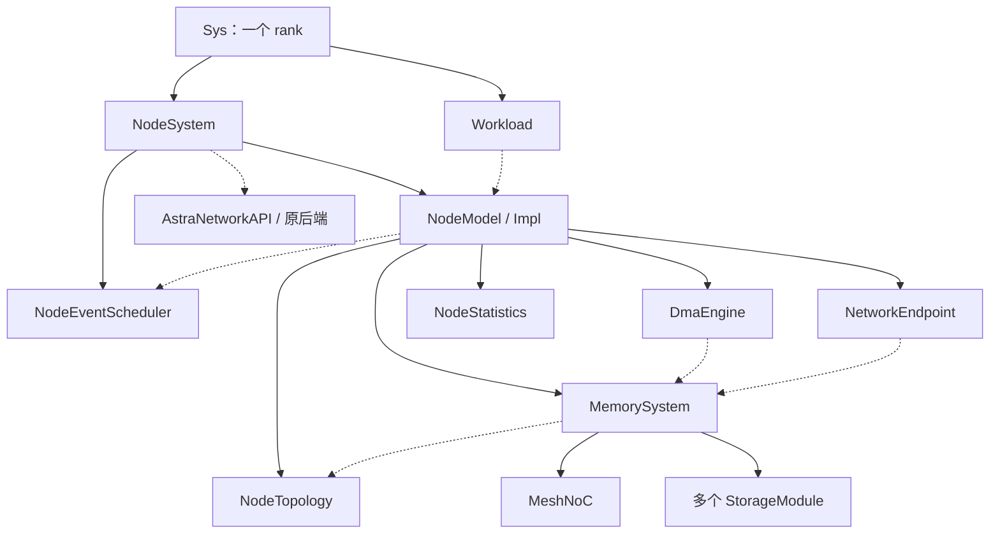
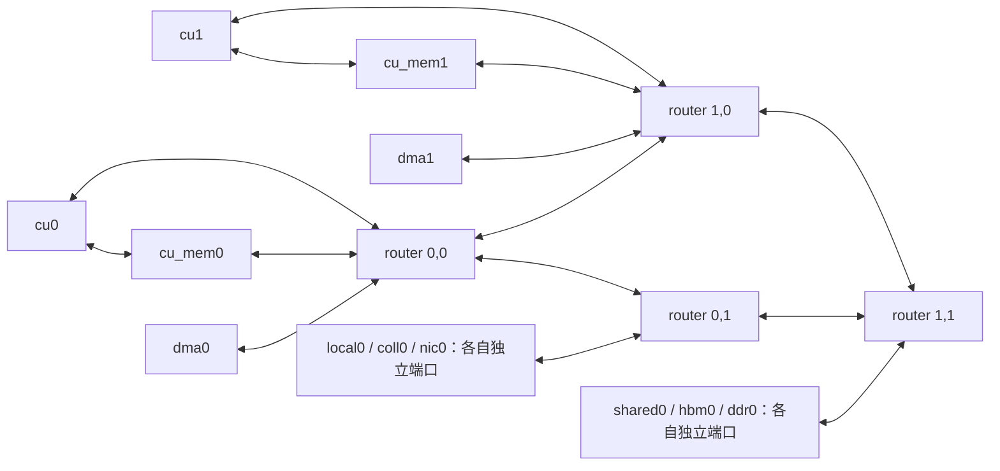
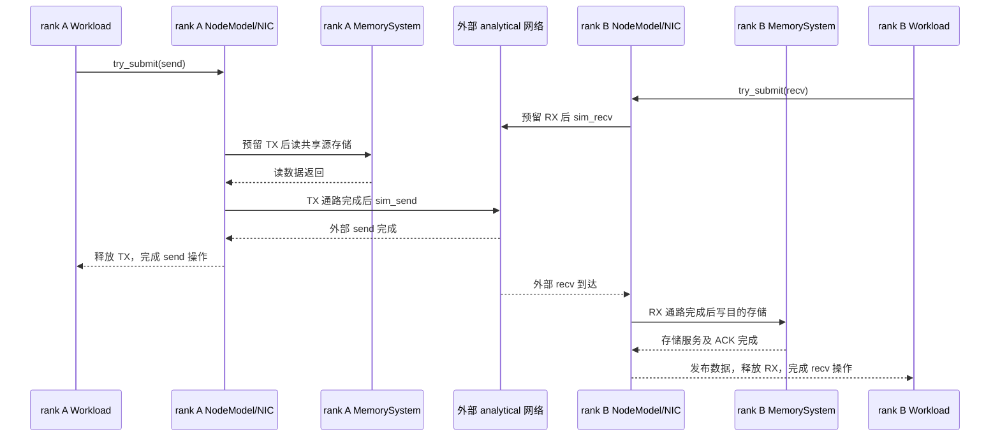

# 计算节点的硬件行为、代码模型与仿真交互

本文对照提交 `9d1776d` 的实际实现编写，日期为 2026-11-12。目标是回答三个问题：每个子模块模拟了什么硬件行为；这些模块怎样连接并推进事件；整个 ASTRA-sim 怎样与这个节点交互。

这里的“硬件规格”指本模型采用的硬件行为契约，不代表某款真实芯片的完整规格。正文分别说明已实现的行为、参数的准确含义和硬件细节的简化，避免把设计设想当成现有功能。

正文导航：

1. [子模块：硬件行为与代码对应](#1-子模块硬件行为与代码一一对应)
2. [节点组成、拓扑、调度与事件推进](#2-子模块怎样组成节点以及节点怎样推进事件)
3. [ET、外部网络、集合通信与远端内存交互](#3-整体仿真怎样与计算节点交互)

相关文档：

- [实现规格与验收约定](node-model-implementation-spec.md)
- [构建、运行与验证说明](node-model.md)
- [完整节点配置](../examples/node/mesh-node.json)
- [算子阶段与数据搬移 profile](../examples/node/mesh-node-profiles.json)

## 阅读约定

一个 `rank` / `Sys` 对应一颗加速器。CU、DMA、存储和 router 都是该加速器内部资源，不增加外部 rank。模型运行在整数纳秒时间线上，`CLOCK_PERIOD = 1`；`bytes_per_ns` 的 1 B/ns 数值上等于十进制 1 GB/s。

模型维护数据的分配、位置、有效区间和使用引用，但不维护 tensor 的真实字节内容，不执行真实数值计算。`read`、`write`、`reduce` 的完成表示相应时序和可见性契约成立，不表示模拟器计算了具体数值。

全文使用三个不同概念：

| 概念 | 硬件含义 | 模型中的典型字段 | 满时行为 |
| --- | --- | --- | --- |
| 显式存储容量 | CU 存储、共享 SRAM、HBM/DDR 中实际分配的数据空间 | `capacity_bytes`、`Allocation.reserved` | 分配失败，报告 `CapacityExceeded` |
| 请求/描述符容量 | 等待或在途的命令、事务状态槽位 | `queue_entries`、`max_outstanding` | 阻塞提交或停止发起新事务，资源释放后重试 |
| 内部数据缓冲 | 模块之间暂存传输数据的空间 | NIC 的 `tx_buffer_bytes/rx_buffer_bytes`、NoC packet credit | 暂时不足则等待；单条消息大于 NIC 总容量则配置/运行时报错 |

DMA 的独立数据 FIFO、DDR 控制器的独立读写数据 FIFO **尚未实现**。不能把已有 `queue_entries` 解释成这些 FIFO 的字节容量。

## 1. 子模块：硬件行为与代码一一对应

### 1.1 总体模块清单

| 硬件/仿真职责 | 实现位置 | 运行状态或入口 |
| --- | --- | --- |
| 节点命令接收、CU 分配、算子阶段依赖 | [NodeModel.cc](../astra-sim/node/NodeModel.cc#L26) 的 `NodeModel::Impl` | `operations`、`order`、`busy`、`eligible`、`Operation.state` |
| 静态模块、端口、连接与路由 | [NodeTopology.hh](../astra-sim/node/NodeTopology.hh) / [NodeTopology.cc](../astra-sim/node/NodeTopology.cc) | `modules_`、`links_`、`attachments_`、`direct_` |
| 显式数据空间和存储服务端口 | [StorageModule.hh](../astra-sim/node/StorageModule.hh) / [StorageModule.cc](../astra-sim/node/StorageModule.cc) | `allocations_`、`occupied_`、`queued_`、`port_`、`retired_` |
| 访存事务与读写返回协议 | [MemorySystem.cc](../astra-sim/node/MemorySystem.cc#L110) | `access()`、`pending_requests_`、`active_` |
| DMA 命令、burst 和并发事务窗口 | [DmaEngine.hh](../astra-sim/node/DmaEngine.hh) / [DmaEngine.cc](../astra-sim/node/DmaEngine.cc) | `Engine.queue/active/port`、`Job.next/inflight/finished` |
| 片内链路竞争、packet 和 credit | [MeshNoC.hh](../astra-sim/node/MeshNoC.hh) / [MeshNoC.cc](../astra-sim/node/MeshNoC.cc) | `Link`、`Packet`、`Transfer`、`source_slots_` |
| 集合通信指令协调 | [NodeModel.cc](../astra-sim/node/NodeModel.cc#L568)、[NodeSystem.cc](../astra-sim/node/NodeSystem.cc#L148) | `prepare_collective()`、`start_collective()`、`ring_transfer()` |
| 专用归约数据通路 | [NetworkEndpoint.cc](../astra-sim/node/NetworkEndpoint.cc#L162) | `finish_receive()`、`reduce_port_` |
| NIC 本地收发暂存与外部收发桥接 | [NetworkEndpoint.hh](../astra-sim/node/NetworkEndpoint.hh) / [NetworkEndpoint.cc](../astra-sim/node/NetworkEndpoint.cc) | `tx_used_/rx_used_`、`tx_port_/rx_port_`、`send_/recv_` |
| 节点事件排序和后端适配 | [NodeEventScheduler.cc](../astra-sim/node/NodeEventScheduler.cc)、[NodeSystem.cc](../astra-sim/node/NodeSystem.cc#L9) | `after()/pump()`、`immediate_`、`Wake` |
| 时间、资源及事务观测 | [NodeStatistics.cc](../astra-sim/node/NodeStatistics.cc) | `RequestContext`、`metrics_`、`events_` |

并不是每一类硬件都有一个同名 C++ 类。例如 CU 的状态由 `NodeModel::Impl` 管理；集合通信的命令槽位、Ring 控制和归约端口分布在三个类中。下面按硬件职责解释，而不是只按文件罗列。

### 1.2 节点命令队列与计算单元 CU

#### 1.2.1 硬件行为契约

节点可以接收多个就绪算子，但命令接收容量有限。一个计算算子分配到一个兼容的 CU；不同 CU 可以并行执行不同算子。同一算子还可以包含分配、DMA、读、计算、写、释放等阶段，阶段依赖由 profile 显式指定。

首版一个计算算子从开始到全部阶段完成，始终占用同一个 CU；即使在等待 DMA 或存储，也不会释放该 CU 给另一个算子。这对应较保守的独占执行上下文，不模拟 CU 内多个算子的细粒度交织。

#### 1.2.2 参数、状态和实现

| 行为/规格 | 参数或状态 | 代码对应 |
| --- | --- | --- |
| 有限节点 admission 容量 | `admission_capacity`；计数为 `operations.size()`，包含已接收待启动和运行中的算子 | [NodeModel::try_submit()](../astra-sim/node/NodeModel.cc#L846) |
| CU 类型匹配及显式绑定 | `compute_units[].kind`、profile 的 `cu_kind/cu_id` | `validate_profile()` 构造 `eligible`；`dispatch()` 选空闲 CU |
| CU 本地存储和访问权限必须匹配 | `local_storage`、storage 的 `scope/clients` | `validate_profile()` 为每个 profile 计算可用 CU 集合 |
| CU 被一个算子独占 | `busy`、`Operation.cu` | [dispatch()](../astra-sim/node/NodeModel.cc#L434) 占用，[finish()](../astra-sim/node/NodeModel.cc#L799) 释放 |
| 依赖满足才启动阶段 | `stages[].deps`；`state` 的 0/1/2 分别为未启动/在途/完成 | [advance()](../astra-sim/node/NodeModel.cc#L706) |
| 同一算子最多 8 个阶段在途 | 固定条件 `inflight < 8`，当前不是 JSON 参数 | `advance()` |
| 同一 CU 的计算阶段共享计算通路 | 每 CU 的 `available_ns`、`busy_ns` | [execute_stage()](../astra-sim/node/NodeModel.cc#L746) |
| 算子占用释放后重试等待命令 | `request_dispatch()` 和 `on_capacity()` | `finish()` 调度 dispatch、完成 observer 和容量通知 |

`dispatch()` 按已接收的 `order` 扫描，会跳过暂时没有兼容资源的算子，继续考察后面的算子；CU 在 `eligible` 的有序集合中选择空闲项。它没有实现复杂的负载预测、抢占或公平调度策略。

对一个 compute 阶段，计算时间为：

```text
duration = startup_ns + ceil(ops / ops_per_ns)
begin    = max(now, CU.available_ns)
end      = begin + duration
CU.available_ns = end
```

`startup_ns` 是**每个 compute 阶段**的启动开销。同一算子中两个无依赖 compute 阶段仍经同一 `available_ns` 串行；它们可以与该算子的独立访存/DMA 阶段重叠，不能凭两个阶段就获得两份 CU 算力。

示例 CU 为 1024 ops/ns、startup 2 ns，10240 ops 的阶段耗时 12 ns。两个 CU 同时执行两个这样的独立算子时，二者都可在 12 ns 完成；后继依赖两者，则最早在 12 ns 开始。这对应 `test_two_cus_and_dependency` 和 `parallel_compute` 测试。

CPU 操作单独占用 `busy["$cpu"]`，当前仅一个槽位。CPU 时长来自 Chakra 的 `duration_micros`，转成 ns；原始时长为零时使用 1 ns。它是运行时间重放，不经过 CU 计算阶段或节点存储事务。详见 [Workload::issue_detailed_nodes()](../astra-sim/workload/Workload.cc#L185)。

#### 1.2.3 简化边界

没有 ISA、SIMT、warp、寄存器端口、指令流水线或算子自动跨 CU 切分。`ops` 和显式阶段图来自 profile，模型不会从总 FLOPs 自动推断数据访问或层级存储位置。

### 1.3 CU 内部、组共享、节点共享、HBM/DDR 存储

#### 1.3.1 存储实例与共享范围

所有层级都用 `StorageModule` 表示，`storages` 是任意长度数组。层级不是自动寻址/回填链，而是不同位置的显式存储实例。

| 硬件含义 | JSON 配置 | 准确代码语义 |
| --- | --- | --- |
| 一个 CU 内部的数据空间 | `scope: cu_private`；一个 CU client | `NodeTopology::allowed()` 按逻辑 requester 检查所属 CU |
| 几个 CU 共享的 local 存储 | `scope: group_local`；多个 CU clients | 只有列出的 requester 被授权；经过具体路由到达实例 |
| 整个节点共享的数据空间 | `scope: node_shared`；`clients: ["*"]` | CU、DMA 委托访问、NIC 和集合通信可使用该空间 |
| SRAM/HBM/DDR 技术类别 | `kind: sram/hbm/ddr` | 校验和记录技术类别；三者当前采用同一套服务公式 |

权限和连通性是两件事。即使 `allowed()` 允许某 requester 访问，实际发起事务的 endpoint 也必须有正反两个方向的路由。DMA 代 CU 访问私有存储时，endpoint 是 DMA，requester 可以是该 CU；不会因为物理发起者是 DMA 就丢失权限归属。

#### 1.3.2 分配、容量和地址

入口是 [MemorySystem::allocate()/release()](../astra-sim/node/MemorySystem.cc#L74)，实际账本在 [StorageModule::allocate()](../astra-sim/node/StorageModule.cc#L28)。

| 硬件/软件契约 | 状态及实现 |
| --- | --- |
| 分配立即占用目的存储，数据还没有搬入也占容量 | `occupied_ += reserved`，分配成功后才更新全节点 `locations_` |
| 按对齐预留字节 | `reserved = ceil(bytes / alignment) * alignment`；地址本身也对齐 |
| 支持指定位置或首次适配分配 | `storage_offset` 或按现有地址区间排序后寻找第一个连续空洞 |
| 地址必须连续且不得与其他分配重叠 | `Allocation.address/reserved`；检查 `AllocationOverlap`、地址越界和碎片 |
| 总空闲量足够但没有连续空间也可能失败 | `CapacityExceeded reason=fragmented` |
| buffer ID 在整个节点内唯一 | `MemorySystem::locations_`；不能在两个 storage 同时 allocate 同一个 ID |
| 释放后重用 ID 必须递增代数 | `generations_` 要求新 generation **恰好是上一代 + 1** |
| 正在使用的分配不能释放 | `Allocation.references > 0` 时报告 `BufferInUse` |

`BufferRef` 的五元组为 `storage + buffer_id + generation + offset + bytes`，其中 offset 相对该 buffer；分配的 `storage_offset` 才是它在存储实例内的地址。地址目前用于空间分配和边界检查，不用于 DDR bank/row 映射。

若要保留同一数据在 HBM 和 CU 存储中的两个副本，需要分配**两个不同 buffer ID**，并显式 copy。不会根据 ID 自动维护跨层副本一致性。

#### 1.3.3 数据有效性与使用生命周期

`Allocation.valid` 是已有效的字节区间集合。`initial_buffers[].initialized=true` 使整个初始分配有效；普通 allocate 默认只是预留空间，没有有效数据。

- `validate(ref, read=true)` 要求读取范围完全落在有效区间内，否则 `DataUnavailable`。
- `validate(ref, read=false)` 检查分配、generation 和边界，不要求旧数据有效。
- `mark_valid()` 合并完成写入的区间，不引入真实内容。
- `retain()/unretain()` 保护分配生命周期；它们不是读写锁，不自动解决两个操作对同一范围的读写冲突。

因此正确的生产者/消费者顺序仍需要 ET 依赖或阶段依赖。模型不提供缓存一致性、失效、自动替换、版本内容比较或一般的数据竞争检测。

代码位置：[allocation()/validate()/mark_valid()](../astra-sim/node/StorageModule.cc#L12)、[BufferRef](../astra-sim/node/StorageModule.hh)。

#### 1.3.4 存储端口、队列与访问时延

存储实例把“容量管理”和“读写服务”放在一个类中。服务模型可理解为：一个固定访问时延前端，加一个读写共享的带宽服务端口，以及有限的未退休服务项。

| 参数/状态 | 硬件意义 | 当前实现 |
| --- | --- | --- |
| `capacity_bytes` | 数据空间总容量 | 分配账本，**不是控制器 FIFO 大小** |
| `access_latency_ns` | 请求到可开始带宽服务的固定延迟 | 请求到达服务端时计算 `now + access_latency_ns` |
| `bytes_per_ns` | 该实例共享的持续服务带宽 | 读、写、直连入口和 NoC 入口都更新同一个 `port_` |
| `queue_entries` | 尚未退休的服务项数量上限 | `queued_`；包含服务中、等待服务和等待响应注入的项 |
| `retired_` | 已完成服务但尚未成功注入响应的完成项 | `drain_completions()` 重试，成功后才归还队列项 |

对已经被接受的请求，到达时间为 `a`，服务字节数为 `n`：

```text
begin    = max(a + access_latency_ns, port_)
duration = ceil(n / bytes_per_ns)
end      = begin + duration
port_    = end
```

多个请求的固定访问延迟可以重叠；带宽服务在 `port_` 上串行。这里不能把每个请求的完整 `access_latency_ns + duration` 都当成独占端口时间。

队列已满时 `try_service()` 返回 false，NoC 保留上游 packet 和 credit。服务完成后，若响应还无法注入 NoC，服务项继续占用 `queue_entries`。一旦响应被 NoC 接受，该服务项可释放，无须等响应最终到达 requester。

实现入口：[try_service()/drain_completions()](../astra-sim/node/StorageModule.cc#L163)。

#### 1.3.5 DDR/HBM 控制器保真度

当前没有独立 `DdrController` 类；DDR 控制器行为折叠在上述 `StorageModule` 服务端中。`kind=ddr` 不会自动增加 bank 并行、行命中、刷新、读写切换、FR-FCFS 调度或写合并。

也没有独立的 DDR 写数据 FIFO、读返回 FIFO 和“先入写缓冲即确认”的路径。当前 write 必须经历存储服务及 ACK 返回，才完成对应访存。

如果以后增加这些硬件细节，应将命令槽位、数据 FIFO 字节容量和真实存储容量分开，明确各自的占用与释放时刻；不能仅把 `queue_entries` 改大就声称已经建模更大的写缓冲。

### 1.4 访存事务前端 MemorySystem

`MemorySystem` 不是额外的一份存储容量，也不是第二个 DDR 控制器。它负责把一个逻辑范围访问转换成有限并发的请求、数据和响应，并调用同一 `StorageModule` 服务。

核心入口：[MemorySystem::access()](../astra-sim/node/MemorySystem.cc#L110)。

| 行为 | 实现 |
| --- | --- |
| 先检查权限、正反向路由、分配和有效性 | `allowed()`、`route()`、`retain(ref, !write)` |
| 将一个范围拆成子事务 | 每个子事务最多 **256 B**，当前固定 |
| 有限并发 | 每个 `access()` 最多 **8 个子事务**在途，当前固定 |
| 子事务读 | 请求 header 到存储 → 存储读服务 → 数据返回 |
| 子事务写 | 数据到存储 → 存储写服务 → ACK 返回 |
| 所有子事务完成后通知调用者 | `Transfer.finished == ref.bytes` |
| 普通写在完整父访问完成后发布有效范围 | `write && publish` 才执行 `mark_valid(ref)` |
| DMA 可延后发布整个 copy 的目的范围 | 子写使用 `publish=false`，由 DMA 完成时统一发布 |

协议具体对应：

```text
read : transmit(endpoint → storage, payload=0, data=false)
       → StorageModule::try_service(write=false)
       → MeshNoC::send(storage → endpoint, payload=part.bytes, data=true)

write: transmit(endpoint → storage, payload=part.bytes, data=true)
       → StorageModule::try_service(write=true)
       → MeshNoC::send(storage → endpoint, payload=0, data=false)
```

零 payload 的请求和 ACK 仍带 `header_bytes`，会消耗链路带宽、时延和控制类 credit。读的完成包括返回数据，写的完成包括返回 ACK，不是只计算单向到达。

`transmit()` 在注入槽不足时把重试闭包放进 `pending_requests_`。它是软件侧待提交状态，不是一份具有独立配置字节容量的硬件 FIFO；产生这些请求的上层操作和事务窗口限制了实际发起范围。

`MemorySystem::payload()` 则只传递有 payload 的片内流量，不访问存储服务端。例如 NIC 到归约单元的入站数据使用此接口；后续读取旧值和写回仍使用 `access()`。

### 1.5 DMA 引擎

#### 1.5.1 命令与执行窗口

DMA 从源存储搬到目的存储，多个引擎各有自己的命令容量和内部带宽。每个引擎当前同时执行**一个描述符**；一个描述符内可以并行多个 burst。

| 硬件行为 | 参数/状态 | 代码对应 |
| --- | --- | --- |
| 目的空间必须先存在，源数据必须有效 | `validate(source,true)`、`validate(destination,false)` | [copy()](../astra-sim/node/DmaEngine.cc#L16) 在发起源读前检查 |
| 可绑定引擎，也可自动选择 | `dma_id` / `binding` | [dispatch()](../astra-sim/node/DmaEngine.cc#L70) 选择兼容且描述符占用最少的引擎 |
| 每引擎描述符容量有限 | `queue_entries` | 计数包含 active 和排队描述符，并考虑待分配命令的预留 |
| 每引擎一个活动描述符 | `Engine.active` | active 为空才弹出 `Engine.queue.front()` |
| 每描述符一次启动开销 | `startup_ns` | 描述符成为 active 后延迟调用 `issue()` |
| burst 大小上限 | `burst_bytes` | 源/目的 BufferRef 切成相同长度的 burst |
| 未完成 burst 窗口 | `max_outstanding`、`Job.inflight` | [issue()](../astra-sim/node/DmaEngine.cc#L115) |
| 内部搬移通路带宽 | `bytes_per_ns`、`Engine.port` | 源读完成后按该带宽串行计费，再发起目的写 |
| 描述符完成 | `Job.finished == source.bytes` | 全部 burst 的目的写和 ACK 完成才释放 active |

未指定引擎时的选择不是按路径拥塞或预计完成时间优化，而是按当前描述符占用计数选择。不同 DMA 引擎的 `port` 独立，但访问的存储端口和 NoC 链路仍是同一批共享资源。

#### 1.5.2 一个 burst 的生命周期

```text
预留 burst 窗口，inflight++
  → memory.access(DMA endpoint, source, read)
  → 等待源读请求、服务和数据返回
  → Engine.port 上支付 ceil(bytes / DMA.bytes_per_ns)
  → memory.access(DMA endpoint, destination, write, publish=false)
  → 等待目的写服务及 ACK
  → inflight--，finished += bytes
  → 有剩余数据则补发 burst；全部完成则发布整个目的范围
```

`max_outstanding` 的槽位从源读发起一直保留到目的写完成，因此它是**完整 copy burst 的窗口**，不是仅限制源端 read outstanding。

DMA burst 还可能被 `MemorySystem` 再拆成 256 B 子事务，每个子事务又被 NoC 拆成 packet。这三层粒度分别由 DMA、访存前端和 NoC 控制，不能当成一个参数。

`burst_bytes × max_outstanding` 给出在途 burst 数据量的上界，但代码没有独立的可变字节数据 FIFO，也没有单独模拟读返回乱序重排缓冲。当前模型把暂存能力与完整 burst 窗口耦合。

队列暂满时 `DmaEngine::copy()` 返回 false；`NodeModel::Impl::copy()` 把提交闭包保留在 `dma_waiters`，并在进入硬件队列前就 retain 源/目的分配，防止等待期间被 free。相关代码见 [NodeModel.cc](../astra-sim/node/NodeModel.cc#L109)。

### 1.6 片内直连与 mesh NoC

#### 1.6.1 拓扑与物理资源

`NodeTopology` 存连接描述，`MeshNoC` 存运行时队列和占用。每个有向 link 有自己的带宽串行器；相反方向是另一个 link。

| 硬件行为 | 配置/状态 | 实现 |
| --- | --- | --- |
| 二维规则 mesh，双向相邻连接 | `noc.rows/columns` | `NodeTopology` 自动创建左右、上下的两条有向 link |
| 模块连接到 router | `noc.attachments[].port/router` | 模块 fabric 的注入和弹出各有独立有向 link |
| CU 直连其私有存储 | `direct_links[].a/b` | 两个方向的独立 link；要求 `CU.mem → storage.local` |
| 确定性 XY 路由 | `noc.routing=xy` | [NodeTopology::route()](../astra-sim/node/NodeTopology.cc#L262) 先 x 后 y，优先使用已定义直连 |
| packet payload 上限 | `packet_payload_bytes` | `wire = payload + header_bytes` |
| 控制与数据分别计 credit | `Link.arrived[2]`、`Link.occupied[2]` | 控制请求/ACK 与数据各一类；同向链路共享一个 `busy` 串行器 |
| 有限链路缓冲 | `input_buffer_packets_per_class` | 每条 mesh/attachment link 每类的 packet 容量 |
| 有限源传输槽 | `source_slots_[{source, traffic}]` | `send()` 按同一个 NoC 配置值限制每源、每类未完成 Transfer 数 |
| 输出仲裁 | `Link.cursor` | [MeshNoC::pump()](../astra-sim/node/MeshNoC.cc#L69) 在候选输入队列之间 round-robin |

直连 link 的缓冲容量当前固定为**每类 8 个 packet**，独立于 mesh link 的可配缓冲值。但直连发起的 Transfer 仍受上述全局 NoC 配置定义的源传输槽限制。

一个 router 上多个模块不会被合并成一个端点：每个 attachment 都有独立注入/弹出 link。共享 router 并不意味着所有端口强制串行；只有竞争同一个有向输出 link 的流量才使用同一串行器。

#### 1.6.2 转发、仲裁和时延

对一个已满足 router 就绪条件且获得输出的 packet：

```text
serialization = ceil((payload + header_bytes) / link.bandwidth)
wire_release  = now + serialization
arrival       = now + serialization + link.latency
next_ready    = arrival + 下一条输出 link 的 router_latency
```

路由处理延迟在进入相应输出前支付。传播延迟期间，当前链路的带宽串行器已经可以服务下一个 packet；但 packet 占用的接收 credit 仍需保留到它继续向下游转发或被端点消费。

代码在开始传输时预留输出 link 对应的接收 credit；如果下一跳 credit 满，该 packet 留在上游输入队列。端点的 `Receiver` 返回 false 时，最终 packet 仍占着上游 credit，从而把存储服务队列的拥塞传回 NoC。

控制/数据类只分离队列和 credit，**没有控制类严格优先级**。同一个输入队列按 FIFO 考察队头，存在事务级队头阻塞；不是完整的任意虚通道路由器模型。

#### 1.6.3 必须注意的 packet 流水限制

当前 `Transfer` 一次只注入一个 packet。该 packet 到达最终端点后，`remaining` 才递减，再注入同一 Transfer 的下一个 packet。也就是说：

```text
同一 Transfer：packet 0 走完整条路径 → packet 1 → packet 2 → ...
不同 Transfer：可以同时位于不同链路，并发生输出竞争
```

这比通常能够让同一长消息的多个 packet 在多 hop 上流水的真实 NoC 更保守。它能估算有向链路争用、有限 credit 和背压，但长路径大消息的吞吐可能偏低；不能将其称为周期精确、flit 精确或完整 packet pipeline 模型。

### 1.7 NIC：本地暂存、收发通路和回调边界

NIC 的硬件契约是：发送前先从节点共享存储取数，接收后先完成本地写入/归约，再通知上层完成。片外网络的路由与拥塞由原 analytical 后端计算。

| 参数/状态 | 含义 | 对应代码 |
| --- | --- | --- |
| `tx_buffer_bytes/rx_buffer_bytes` | 已预留 TX/RX 消息的总字节上限，两方向独立 | `tx_used_/rx_used_` |
| `bytes_per_ns` | NIC 本地收发通路带宽 | `tx_port_/rx_port_` 两个独立串行器使用同一配置速率 |
| `startup_ns` | 每条消息在 TX/RX 本地通路上的开销 | `send()` 与 `finish_receive()` |
| `tx_wait_/rx_wait_` | 等待本地暂存预留的提交闭包 | `retry()` 在完成释放空间后重试 |
| `send_/recv_` | 调用原网络后端的异步函数 | `NodeModel::Transport` 经 `NodeSystem` 注入 |

发送路径，见 [NetworkEndpoint::send()](../astra-sim/node/NetworkEndpoint.cc#L39)：

1. 检查 node_shared 源、有效数据、单消息不超过 TX 总容量，并 retain 分配。
2. 为**整条消息**预留 TX 字节；空间暂不足则等待。
3. `memory.access(nic, nic, source, read)`，付出存储读和 NoC 往返时延。
4. 在 `tx_port_` 上支付 `startup_ns + ceil(message_bytes / bytes_per_ns)`。
5. 调用外部 `send_`；此刻才是实际对外提交时间。
6. 外部 send 完成回调返回后释放 TX 预留和源引用，通知上层。

接收路径，见 [recv()/finish_receive()](../astra-sim/node/NetworkEndpoint.cc#L108)：

1. 检查 node_shared 目的已分配，预留整条消息的 RX 字节，再调用外部 `recv_` 登记接收。
2. 外部到达回调触发后，在 `rx_port_` 上支付本地接收通路时延。
3. 普通 recv 经 NoC 写目的存储；带归约的 recv 进入下一节的归约路径。
4. 本地写及响应完成后，才释放 RX 预留和目的引用并通知上层。

TX 预留从本地取数前持续到外部 send 回调；RX 预留从登记接收前持续到本地最终写完成。这是保守的整消息 staging 预留，不是逐字节填充的 FIFO 水位仿真。

`tx_wait_/rx_wait_` 没有独立可配置的硬件队列条数；等待状态由上层在途操作/stream 及内存引用持有。NIC 缓冲是本地约束，不能反推出外部链路存在相同的硬件 credit 协议。

### 1.8 集合通信控制单元与专用归约通路

#### 1.8.1 控制资源和归约资源分开解释

| 硬件职责 | 状态/参数 | 代码位置 |
| --- | --- | --- |
| 集合通信命令容量 | `collective_engine.queue_entries`；统计已接收的 collective 数，包含待启动和运行中 | `NodeModel::try_submit()` |
| 同时活动的 collective 个数 | `collective_engine.slots`、`active_collectives` | `NodeModel::Impl::dispatch()` |
| 同一 communicator 顺序 | `communicator_busy`；`participants + pg_name` 为 key | `dispatch()/finish()` |
| 每个 collective 的启动 | `collective_engine.startup_ns` | `prepare_collective()` 在初始化 DMA 前支付 |
| Ring 算法状态机 | 原 `Ring`、`StreamBaseline`、`DataSet` | `NodeSystem::start_collective()/ring_transfer()` 桥接 |
| 实际局部归约吞吐 | `reduce_bytes_per_ns`、单个 `reduce_port_` | `NetworkEndpoint::finish_receive()` |

`slots > 1` 允许不同 communicator 的多个 collective 活动，但当前**归约带宽串行器仍只有一个**。它没有随 slots 自动复制归约流水线。

#### 1.8.2 一次入站归约的硬件数据流

```text
外部消息到达 NIC
  → NIC RX 通路
  → memory.payload(NIC → collective_engine)，消耗片内 NoC
  → memory.access(collective_engine → destination, read)，读取本地旧值
  → reduce_port_ 上支付 ceil(bytes / reduce_bytes_per_ns)
  → memory.access(collective_engine → destination, write)，写回并等待 ACK
  → 本地归约完成，释放 RX 预留，允许 Ring 推进
```

归约算力独立于 CU 的 `ops_per_ns`，但旧值读、结果写和 NIC→归约单元的数据传输都竞争现有存储与 NoC。它没有一份不受争用的隐藏存储副本。

当前每次归约不额外支付 `collective_engine.startup_ns`；该参数用于整个 collective 的启动。归约数值、数据类型运算语义和逐元素 ALU 不模拟，`elem_bytes` 用于消息大小对齐检查。

#### 1.8.3 四种 collective 的本地数据布局

设组大小为 `P`、输入长度为 `I`、输出长度为 `O`：

| 操作 | 长度契约 | 初始化/工作区 | Ring 与完成行为 |
| --- | --- | --- | --- |
| All-Reduce | `O = I` | 输入 DMA 到 workspace；默认 workspace 为 output | Reduce-Scatter 阶段接收归约，All-Gather 阶段接收覆盖写；独立 workspace 最后回拷 output |
| Reduce-Scatter | `O = I/P`，要求整除 | 显式 workspace 至少 `I`，先拷入完整输入 | 每次接收归约；最后一轮把属于本 rank 的结果块 DMA 到 output |
| All-Gather | `O = I×P` | workspace 至少 `O`；本 rank 输入拷入其对应位置 | 接收后普通写，传播各 rank 数据；独立 workspace 最后回拷 output |
| All-to-All | `O = I` | 显式 workspace 至少 `I/P`；先将本 rank 对自身的分块拷到 output | 按 Ring 距离逐跳转发；中间跳用 workspace，最终跳落到目标 output 范围 |

初始化和结果回拷调用真正的 DMA `copy()`，会等待描述符、访问存储并占 NoC。输入、输出和 workspace 必须事先分配并满足重叠限制；它们的空间都计入存储容量。

多 rank 的 Reduce-Scatter 和 All-to-All 工作区不得与 output 重叠；所有操作的 workspace 都不得覆盖 input。All-Reduce/All-Gather 可从 output 起始位置使用 workspace。singleton 经过本地初始化及必要回拷，不发实际网络消息。

同一次 Ring step 通常并行登记 recv 与 send，并等待二者完成；如果源/目的使用同一重叠 scratch 范围，则先等 send 完成，再登记 recv，避免转发数据过早被覆盖。代码见 [NodeModel::collective_step()](../astra-sim/node/NodeModel.cc#L1004)。

### 1.9 统计模块：观察模型，不是额外硬件

`RequestContext` 将 `operation/transaction/parent/stage` 带到访存、DMA、NoC 和外部收发。`NodeStatistics::child()` 创建子事务，`record()` 加入 rank、模块和 `tick_ns`，可追溯一个阶段怎样产生多笔存储事务和 packet。

| 字段 | 实际统计口径 |
| --- | --- |
| `admission_wait_ns` | 首次尝试提交到成功接收的时间 |
| `cu_wait_ns` | 成功接收到 dispatch 启动的时间；代码对各种操作写这个字段，因此 collective 上也可能包含等控制槽位的时间 |
| `compute_busy_ns` | compute 阶段的服务时间累计，不是整个算子占 CU 的时长 |
| `memory_stall_ns` | 每次完整 `MemorySystem::access()` 的起止时间累计 |
| `dma_wait_ns` | 等硬件描述符接收，以及已接收描述符等待 active 的时间累计 |
| `noc_wait_ns` | packet 在链路/端点等待的累计值；不等于所有 NoC 传输时间 |
| `storage_queue_wait_ns` | 已接受服务项的 `begin - (arrival + fixed_latency)`，不包含所有上游背压时间 |
| `external_network_wait_ns` | send 提交/recv 登记到相应外部回调的时间累计 |

这些指标可以重叠，多请求并发时累计量可能超过 wall time。它们不能直接相加还原算子时长，也不构成完整的严格因果关键路径归因。

trace 配置为 `trace: {"enabled": true, "max_events": 10000}`；默认不开启，默认上限 10000。超过上限设置 `truncated=true`。链路、存储和操作信息见 [NodeStatistics.cc](../astra-sim/node/NodeStatistics.cc#L41) 与 [NodeModel::statistics()](../astra-sim/node/NodeModel.cc#L950)。

## 2. 子模块怎样组成节点，以及节点怎样推进事件

### 2.1 C++ 对象组织与硬件连接是两张不同的图

下面是所有权与调用组织。实线表示主要持有关系，虚线表示引用或回调依赖：



这些 C++ 持有关系不是硬件总线。真正的数据连接保存在 `NodeTopology` 的端口/link 图中。`DmaEngine` 调用 `MemorySystem` 也不意味着 DMA 能跳过 NoC 直接访问存储：`access()` 会根据 DMA endpoint 和存储 endpoint 查真实路径并竞争相应资源。

`NodeModel::Impl` 的初始化顺序是 topology → telemetry → memory → dma → endpoint。`MemorySystem` 为每个 storage 配置创建一个 `StorageModule`，并创建共享 `MeshNoC`。CU 和 collective 控制单元当前不另建同名对象，它们的配置与资源状态分别保存在 `NodeTopology`、`NodeModel` 和 `NetworkEndpoint` 中。

### 2.2 配置里的拓扑如何变成运行图

节点 JSON 有两组承载物理连接的配置：

```json
{
  "direct_links": [
    {"a": "cu0.mem", "b": "cu_mem0.local", "bytes_per_ns": 64, "latency_ns": 1}
  ],
  "noc": {
    "rows": 2,
    "columns": 2,
    "routing": "xy",
    "attachments": [
      {"port": "cu0.fabric", "router": [0, 0]},
      {"port": "hbm0.fabric", "router": [1, 1]}
    ]
  }
}
```

这是连接字段的节选，不是可独立运行的完整配置。其余必填参数见 [mesh-node.json](../examples/node/mesh-node.json)。

| 配置/硬件概念 | 构造结果 | 关键校验 |
| --- | --- | --- |
| 模块实例 | `modules_[id]` 与 `types_[id]` | ID 唯一，类型和参数合法 |
| `module.fabric` | 模块接入 mesh 的端口 | 模块存在，端口名称合法，只能绑定一次 |
| `CU.mem` / `storage.local` | CU 私有存储直连端口 | CU 的 `local_storage` 必须就是该 storage |
| `[x,y]` attachment | `attachments_[module]` 和两条有向 endpoint link | 坐标在 mesh 范围内 |
| 相邻 router | 自动建立正反两个方向的 link | 带宽、latency、buffer 来自 NoC 配置 |
| 实际流量资源 | `MeshNoC::links_[link_id]` | 与静态 `LinkDescription` 一一对应 |

代码入口是 [NodeTopology 构造器](../astra-sim/node/NodeTopology.cc#L45)、`bind()`、`link()`、`route()`。

拓扑支持规则 mesh 和 CU 私有存储直连；不能用这些字段定义任意不规则 router 图、多个 NIC 或任意端口类型。一个模块目前只通过一个 fabric attachment 接入 mesh。

### 2.3 示例节点的具体连接和路径

示例配置的 attachment 分布如下。坐标不代表芯片几何面积，只用来决定 hop 和竞争关系。

| Router | 接入模块 |
| --- | --- |
| `(0,0)` | `cu0`、`cu_mem0`、`dma0` |
| `(1,0)` | `cu1`、`cu_mem1`、`dma1` |
| `(0,1)` | `local0`、`coll0`、`nic0` |
| `(1,1)` | `shared0`、`hbm0`、`ddr0` |

另有 `cu0.mem ↔ cu_mem0.local`、`cu1.mem ↔ cu_mem1.local` 两组直连。



图中两个合并标签仅用于节省画图空间，实际每个模块都有自己的 endpoint link。

几个容易混淆的实际路径：

1. CU0 读自己的私有存储：`cu0.mem → cu_mem0.local`，优先走直连；返回走对应反向直连。
2. CU0 读 HBM：请求 `cu0.fabric → R00 → R10 → R11 → hbm0.fabric`。
3. HBM 返回 CU0：重新按 XY 求路，`hbm0.fabric → R11 → R01 → R00 → cu0.fabric`。返回路径不必是请求路径的逆序。
4. DMA0 写 CU0 私有存储：`dma0.fabric → R00 → cu_mem0.fabric`。权限 requester 可以是 `cu0`，但物理 endpoint 仍是 `dma0`，不会使用 `cu0.mem` 那条直连。
5. CU0 直连访问和 DMA0 fabric 访问同一个 `cu_mem0` 时，最后都进入同一个 `StorageModule`，共享它的服务带宽和队列。

因此拓扑位置、共享范围和带宽三者都重要：把 storage 绑定到更近的 router 只改变路径；不会自动扩大 clients，也不会增加该 storage 的内部带宽。

### 2.4 节点的构造与配置加载

完整构造调用链为：

```text
analytical congestion-aware main
  → 为每个 rank 创建 CongestionAwareNetworkApi 和 Sys
  → Sys::initialize_sys(system_configuration)
  → 发现 system JSON 的 node-model-config
  → NodeSystem(Sys&, node_config_path)
  → NodeModel::load() 读取节点 JSON 与 operation_profiles
  → NodeTopology / MemorySystem / DMA / NIC 构造，校验 profile
  → initial_buffers 分配和初始化有效区间
  → NodeSystem 注入 Transport 的 send/recv/collective/remote 回调
  → Sys 创建 Workload，注册 model.on_capacity()
```

`node-model-config` 相对 system 配置文件所在目录解析；`operation_profiles` 相对节点 JSON 所在目录解析。不是相对当前 shell 工作目录。

`NodeSystem` 构造时只保存涉及 Workload 的闭包，不在 Workload 尚未创建时执行这些闭包。运行阶段才由 collective/remote 操作调用。

配置入口见 [Sys::initialize_sys()](../astra-sim/system/Sys.cc#L314)、[NodeModel::load()](../astra-sim/node/NodeModel.cc#L840)、[NodeSystem 构造器](../astra-sim/node/NodeSystem.cc#L9)。没有 `node-model-config` 时使用原 legacy 路径。detailed 模式会拒绝 roofline/replay 冲突、非 Ring/custom collective 和未声明支持节点模型的后端。

### 2.5 一个算子的完整状态变化

这里有两层依赖：ET DAG 描述**算子之间**的依赖；profile stages 描述**算子内部**的依赖。只有 ET ready 不意味着 CU、DMA 或存储已经可用。

| 状态 | 触发及维护者 | 资源含义 |
| --- | --- | --- |
| ET 就绪、尚未接收 | `Workload::issue_detailed_nodes()` | 依赖满足，但还可能遇到 admission 满 |
| 提交暂未接受 | `try_submit()` 返回 false | 不执行 `resolver.take_node()`，该 ET 节点仍可重试 |
| 已接受、等待 dispatch | `operations[id]`、`order` | 占 admission；尚未获得 CU 或 collective 活动槽 |
| 已启动 | `dispatch()` 设置 `running/start`，调用 started observer | 获得相应 CU/控制资源；Workload 记录开始时间 |
| 内部阶段运行 | `advance()` / `execute_operation()` | 等依赖、队列、链路、存储或外部回调 |
| 模型操作结束 | `finish()` | 释放 CU/collective 控制资源，记录 end，移除 operations |
| ET 节点完成 | phase 3 的 completed observer | `complete_detailed()` 记录结束、`resolver.finish_node()`，后继才可提交 |

接收返回 true 和 started observer 不会同步发生：`request_dispatch()` 通过调度器安排事件。因此 Workload 有机会在启动/完成回调前将已接受 ET 节点标记为 ongoing。

模型操作移除与 ET 完成 observer 之间允许存在同 tick 的 delta 间隔；不能只看 `operations.empty()` 就认定 Workload 已结束。

### 2.6 统一时间线：三层事件机制

节点没有自己的物理时钟推进循环。它从外部后端读 `sim_get_time()`，需要未来发生的事情也通过原后端安排。

| 层次 | 数据结构/职责 | 时间是否由该层主动前进 |
| --- | --- | --- |
| analytical 全局事件队列 | `EventQueue` / `EventList`，包含各 rank 和外部网络事件 | 是，`proceed()` 跳到下一个事件时间 |
| 每个 Sys 的事件桶 | `event_queue[tick]`，保存 Callable/EventType/CallData | 否，通过 `comm_NI->sim_schedule()` 唤醒 |
| 节点局部事件排序 | `NodeEventScheduler::events_[tick]`，保存 callback/delta/phase/sequence | 否，在对应后端时间到达后执行 pump |

未来事件调用链：

```text
子模块 clock.after(delay > 0, callback)
  → NodeEventScheduler 在目标 tick 的桶中追加 callback
  → 该 tick 首次需要唤醒时调用 HostSchedule
  → NodeSystem 创建 Wake
  → Sys::register_event(NodeSystem, General, Wake, delay)
  → Sys::try_register_event() 在本 Sys 的目标 tick 桶追加 callable
  → 本 Sys 该 tick 首次注册时，comm_NI->sim_schedule()
  → analytical EventQueue 到达该 tick
  → Sys::handleEvent(CallEvents) → Sys::call_events()
  → NodeSystem::call() → Wake.callback → NodeEventScheduler::pump(tick)
```

出处：[NodeSystem.cc](../astra-sim/node/NodeSystem.cc#L9)、[Sys::try_register_event()](../astra-sim/system/Sys.cc#L533)、[CommonNetworkApi::sim_schedule()](../astra-sim/network_frontend/analytical/common/CommonNetworkApi.cc)、[EventQueue::proceed()](../extern/network_backend/analytical/common/event-queue/EventQueue.cpp)。

模型安排的是“多少纳秒后发生状态变化”，不是启动真实线程等待，也不是每纳秒轮询所有模块。没有活动事件的时间区间由全局事件队列直接跳过。

#### 2.6.1 同 tick 事件、delta 与 phase

`NodeEventScheduler::after()` 和 [pump()](../astra-sim/node/NodeEventScheduler.cc#L26) 的规则是：

1. 事件按目标物理 tick 分桶；同一批中的排序键是 `(delta, phase, sequence)`。
2. pump 正在运行时安排 `after(0)`，新事件使用当前 delta + 1，进入下一批，不递归执行。
3. pump 外安排 `after(0)`，由 `NodeSystem::immediate_` 暂存零时延的 host pump。
4. `NodeSystem::drain()` 排空 immediate 闭包，必要时继续处理新产生的同 tick 工作；重入由 `draining_` 阻止。
5. delta 只表示同一物理时间内的因果先后，**不增加 1 ns**。

phase 的典型用法如下：

| phase | 当前代码中的典型事件 |
| --- | --- |
| 0 | 计算服务结束、链路带宽释放、存储服务结束、资源容量通知 |
| 1 | packet 到达、读写完成、网络回调续接 |
| 2，默认值 | 调度、阶段续接、一般重试 |
| 3 | 操作完成 observer、collective 最终完成 |

这是节点局部的稳定排序约定，不是整个后端所有同 tick 事件的全局优先级。`pump()` 先取出一个 batch 再排序执行，执行中产生的事件在后续 batch；新产生的低 phase 事件也不会抢占已经在执行的 batch。

启动时的零时延操作由 `immediate_` 处理，不必在全局队列创建 t=0 的新时间点。正时延事件则必须回到原全局时间线，才能与别的 rank 和外部网络正确交错。

#### 2.6.2 资源服务结束与端到端完成不同

以一次 NoC 转发为例：

- `serialization` 后只释放链路的 `busy`，允许发送下一个 packet。
- `serialization + latency` 后 packet 到下一输入缓冲。
- 消费或转发离开该输入缓冲后才归还对应 credit。
- 最终端点接受最后一个 packet 后，才触发 Transfer 完成。

同理，存储 `port_` 到时间、响应成功注入、响应抵达 requester、父访存完成、整个算子完成，是不同层次的事件。模型用回调串联这些层次，没有将它们折叠成一个固定延时。

### 2.7 背压如何贯穿各模块

| 阻塞位置 | 如何保存等待状态 | 解除阻塞的事件 |
| --- | --- | --- |
| 节点 admission / collective 命令容量满 | ET 节点仍留在 resolver ready 集合 | `finish()` 的容量通知重新调用 Workload 提交 |
| CU 或 collective 活动槽被占 | 已接受 Operation 保留在 `order` | `finish()` 后 `request_dispatch()` |
| DMA 描述符暂不可接受 | `dma_waiters`，保留 buffer 引用 | DMA 完成通知 `on_capacity()` |
| DMA burst 窗口满 | `Job.next/inflight` | 一个 burst 的目的写 ACK 完成后 `issue()` 补发 |
| 访存子事务窗口满 | `Transfer.next/inflight` | 子事务完成后续发 |
| 源 NoC Transfer 槽满 | `pending_requests_` | NoC Transfer 完成的容量通知 |
| NoC 下游 packet credit 满 | packet 停在输入队头，继续占上游 credit | 下游 packet 转发/消费后的 `wake()` |
| 存储服务项满 | NoC 最终 packet 的 receiver 返回 false | `StorageModule` 释放项后 `network_.wake()` |
| 存储响应不能注入 | `retired_`，继续占服务项 | NoC 容量通知重试 `drain_completions()` |
| NIC 暂存空间不足 | `tx_wait_/rx_wait_`，保留 buffer 引用 | 本地收发完成释放预留后 `retry()` |

这构成闭环：例如 DDR 响应发不出去，会占着 DDR 服务项；DDR 队列满后拒收 NoC 请求；请求 packet 保留 credit，进而让 DMA 的源读无法完成；DMA burst 窗口耗尽后停止发起新读。计算阶段如果依赖该 DMA，自然也会推迟。

容量分配失败与这种可恢复背压不同。`CapacityExceeded` 不会等待“未来也许有人释放空间”，也不会自动溢出到其他层。

### 2.8 一个可手算的完整读事务

[read_round_trip 测试](../tests/node_model/node_model_test.cc#L160) 使用 1×2 mesh：CU 在 `(0,0)`，共享存储在 `(1,0)`。链路 32 B/ns、传播 1 ns、router 延迟 1 ns、header 16 B、payload 上限 64 B；存储固定时延 5 ns、带宽 32 B/ns。

读取 64 B、无其他竞争时：

| 部分 | 计算 | 用时 |
| --- | --- | --- |
| CU → R00 的控制请求 | `ceil(16/32) + 1`，注入没有 router 延迟 | 2 ns |
| R00 → R10 | `1 + ceil(16/32) + 1` | 3 ns |
| R10 → storage | `1 + ceil(16/32) + 1` | 3 ns |
| 存储读服务 | `5 + ceil(64/32)` | 7 ns |
| storage → R10 的数据响应 | `ceil((64+16)/32) + 1` | 4 ns |
| R10 → R00 | `1 + ceil(80/32) + 1` | 5 ns |
| R00 → CU | `1 + ceil(80/32) + 1` | 5 ns |
| 总计 | 请求 8 + 存储 7 + 返回 14 | **29 ns** |

这 29 ns 由多个资源事件推进得到。加入竞争时，各 hop 的就绪/仲裁/credit 等待和存储端口等待会改变实际结束时间；无须修改 read 操作本身的固定时延常量。

### 2.9 正常结束、停滞与异常

正常结束需要 ET 没有 ready/ongoing 节点，且 `NodeModel::idle()` 为真。该 idle 检查 operations、memory、DMA、NIC；memory idle 还要求 NoC 没有活动 Transfer。存活的最终输出分配不会使节点判为忙。

`NodeEventScheduler::idle()` 是独立的事件队列状态，`NodeModel::idle()` 没有直接将它合入条件。`NodeSystem::drain()` 在局部即时工作排空后重新检查 Workload，避免最后一个资源续接晚于 ET 完成 observer 时遗漏收尾；主循环还会继续排空全局事件。

若全局事件队列已空，但某 rank 的模型或 Workload 未完成，main 报 `NoProgress`，并输出 ready/ongoing ET 节点、未完成阶段、NoC 队头、在途访存等诊断。这是“当前已经无法推进”的检测，不是完整死锁证明，也不是定时超时轮询。

容量、非法引用等异步异常不能直接穿过 analytical 后端的 `noexcept` 事件回调。当前处理方式是：

```text
NodeSystem::drain()/network_completed() 或 Sys::call_events() 捕获异常
  → NodeSystem::fail(exception_ptr) 保留第一个错误
  → 停止该失败节点的相关推进
  → main 在 fire()/EventQueue::proceed() 返回后 rethrow_if_failed()
  → main catch 打印原错误，返回 1
```

这样异步容量错误仍保留 `CapacityExceeded` 和阶段信息，而不会被吞掉后只剩 `NoProgress`，也不会直接穿越 noexcept 导致进程 abort。

## 3. 整体仿真怎样与计算节点交互

### 3.1 四个外部边界

从节点外部看，并不存在一个统一的“输入事件、返回固定耗时”接口。实际有四个协作边界：

| 外部参与者 | 送入节点/节点向其提交 | 返回的东西 | 代码接口 |
| --- | --- | --- | --- |
| Workload / Chakra ET | 就绪算子的 ID、profile、ET 元信息 | 是否接受，以及 started/completed observer | `NodeModel::try_submit()` |
| 全局仿真器 | 后端当前时间；节点申请未来回调 | 在指定仿真时间调用 callback | `sim_get_time()`、`sim_schedule()` |
| 其他 rank / 片外网络 | 节点发送或登记接收 `(peer, tag, bytes)` | 原后端 send/recv 完成回调 | `NodeModel::Transport` → `Sys::sim_send/recv()` |
| 原远端内存后端 | 节点提交 `remote_bytes` | 远端内存服务结束回调 | `Workload::issue_node_remote()` → `remote_mem->issue()` |

外部网络配置决定创建多少个 `Sys/rank`；节点 JSON 决定每个 rank 内有哪些子模块。远端内存配置中的 `num-npus-per-node` 用于原远端内存后端的分组，不会把一个新的 NodeModel 拆成多个外部 rank。

### 3.2 从 ET 到硬件操作

[Workload::issue_detailed_nodes()](../astra-sim/workload/Workload.cc#L185) 从 dependency resolver 获取 ready 节点，按 ID 排序尝试提交；detailed 模式不使用旧 `HardwareResource` 的 GPU 单槽来限制节点内多 CU 并发。

| ET 节点 | profile 的 `kind` | Workload 额外提供的元信息 | 节点执行 |
| --- | --- | --- | --- |
| 非 CPU `COMP_NODE` | `compute` | `et_type` | CU 绑定与 stages |
| `MEM_LOAD_NODE` / `MEM_STORE_NODE` | `local_dma` | `tensor_size`，主要供相应操作路径使用 | profile 指定源/目的的本地 copy |
| `MEM_LOAD_NODE` / `MEM_STORE_NODE` | `remote_memory` | `tensor_size`、ET load/store 类型 | 远端服务与本地读/写串联 |
| `COMM_SEND_NODE` / `COMM_RECV_NODE` | `send` / `recv` | peer、tag、comm_size | NIC 本地 staging 与实际外部消息 |
| `COMM_COLL_NODE` | `collective` | communicator、comm_type、comm_size | 初始化、Ring、多轮局部处理、最终回拷 |
| `is_cpu_op=true` | 不要求节点硬件 profile | 转换后的 cpu_runtime_ns | 单槽 CPU 重放 |
| INVALID / METADATA | 不提交硬件操作 | communicator metadata 需要时解析 | 直接完成控制节点，并异步继续考察 ready 集合 |

非 CPU 操作通过 ET 属性 `node_model_profile` 选择外部 profile 文件中的条目。缺少 profile、ET 类型不匹配或非法数据范围会报错，不会自动回退成 `duration_micros` 固定延迟。

对于 collective、点对点和 remote_memory，实际发起时会校验 profile 的消息大小与 ET 相应字段。`local_dma` 的长度由 profile 源/目的引用确定，当前没有对应的 ET `tensor_size` 一致性校验；不能把这个检查泛化到所有 MEM 节点。

阶段 `dma_copy` 也可以嵌在 compute profile 中，不必在 ET 中为每次局部搬移创建独立节点。反过来，仅有一个 ET 计算节点的总运算量，不能表达它在 CU 内存储、shared SRAM 和 HBM 之间的访问序列。

### 3.3 公开操作接口的接收、开始和完成契约

公开入口定义见 [NodeModel.hh](../astra-sim/node/NodeModel.hh)：

```cpp
bool try_submit(uint64_t id,
                const std::string& profile,
                json metadata,
                Observer started,
                Observer completed);
// Observer: void(uint64_t operation_id, Tick simulation_time)
```

- `false` 表示当前 admission 或 collective 命令容量不足；不代表操作失败，也没有获得一个预计时长。
- `true` 表示操作被接受，可能还在等 CU、collective slot 或后续硬件队列。
- `started` 表示节点调度器已让该操作进入执行，Workload 在此记录统计起点。
- `completed` 表示内部执行和必要的外部回调、本地最终可见性处理已结束；Workload 在此解除 ET 依赖。

CPU 重放和纯 compute 的服务时长可以提前按公式算出；一般 DMA/通信/访存的完成时间依赖未来竞争和对端行为，接口采用异步完成回调。

每个已接受的操作 ID 在同一 NodeModel 生命周期内只能使用一次。collective 的 `instance_id` 也不能在同一 communicator 中重复使用。

### 3.4 从节点 NIC 到原片外网络后端

`NodeSystem` 在构造时创建四个 `Transport` 回调。send/recv 的具体适配见 [NodeSystem.cc](../astra-sim/node/NodeSystem.cc#L9)：

```text
NetworkEndpoint::send()/recv()
  → 注入的 Transport.send/recv(peer, tag, bytes, done)
  → 分配 NetworkCallback，保留 NodeSystem*、done、sim_request
  → sim_request 设置 srcRank/dstRank/reqCount/tag/reqType=UINT8
  → Sys::sim_send/recv(delay=0, Sys::dummy_data, ...)
  → comm_NI->sim_send/recv(..., NodeSystem::network_completed, callback)
```

外部只接收到 rank、tag、长度和回调等网络信息，**不会接收到节点内部 BufferRef、storage ID、DMA ID 或 mesh 路由**。节点在消息上下文和闭包中保存本地 buffer 及后续处理。

`Sys::dummy_data` 不携带真实 tensor 内容。代码模拟的是消息长度、时序、匹配和本地可见性，不做跨 rank 的真实数值交换。

这些 detailed send/recv 直接使用 [Sys::sim_send()/sim_recv()](../astra-sim/system/Sys.cc#L1423)，没有调用 `front_end_sim_send/recv()` 包装。因此这里不会经过那层 legacy rendezvous 握手和相关包装处理；不能仅因为存在相应命令行开关，就认为 detailed 路径也模拟了它们。

### 3.5 原后端怎样匹配消息，以及外部完成意味着什么

send 入口是 [CongestionAwareNetworkApi::sim_send()](../astra-sim/network_frontend/analytical/congestion_aware/CongestionAwareNetworkApi.cc)。它创建外部 `Chunk`，由原物理拓扑对 `src → dst` 求路并推进拥塞。节点内部的 MeshNoC 与这个片外网络是两套不同资源图，共用同一时间线。

消息匹配由 [CommonNetworkApi](../astra-sim/network_frontend/analytical/common/CommonNetworkApi.cc)、`ChunkIdGenerator` 和 [CallbackTrackerEntry](../astra-sim/network_frontend/analytical/common/CallbackTrackerEntry.cc) 完成，关键包括 `tag/src/dst/count/chunk_id`。

| 外部状态 | 当前后端行为 |
| --- | --- |
| recv 先登记，send 尚未出现 | tracker 保存 recv callback |
| send 先出现，传输尚未完成 | 创建/更新 tracker 并开始片外网络传输 |
| Chunk 到达，send/recv callback 都已登记 | 先调用 send callback，再调用 recv callback，随后删除 tracker 项 |
| Chunk 已到达，但 recv 尚未登记 | 仍调用 send callback，并标记 transmission_finished |
| 之后 recv 才登记 | 安排同 tick 的 recv callback |

这意味着：

1. 本后端的 send 完成对应外部 Chunk 传输到达；即使对端尚未登记 recv，它也可以完成。
2. recv 的外部回调表示数据传输已满足该后端的到达/匹配条件，**不表示目的节点的 SRAM/HBM 已完成写入**。
3. 对端 NIC 暂存空间不足、推迟登记 recv，并不一定能阻止本后端先完成网络传输。后端可以暂存“已传输完成”的匹配状态。

所以当前 NIC 本地预留不是端到端物理 credit，也不是完整 RDMA/MPI 协议。更真实的外部接收窗口和链路背压需要扩展原网络后端。

### 3.6 外部回调怎样重新进入节点事件流

[NodeSystem::network_completed()](../astra-sim/node/NodeSystem.cc#L135) 不直接在外部后端栈中完成 ET 节点，而是：

```text
后端调用 network_completed(void*)
  → 按确切 NetworkCallback 类型接管并销毁回调对象
  → scheduler.after(0, 原 done, phase=1)
  → NodeSystem::drain()
  → NetworkEndpoint 的发送完成或接收后处理
  → 必要的本地 NoC、存储、归约事件
  → NodeModel::finish()
  → phase 3 completed observer
  → Workload::complete_detailed()
```

外部 send 回调释放发送方的 TX 预留；外部 recv 回调启动接收方 RX/本地写入。发送方 ET send 节点和接收方 ET recv 节点的完成时刻因此可以不同。

以下时序图只展示两个节点的普通点对点消息；省略多层 helper 和零时延 delta：



### 3.7 集合通信怎样复用原 Ring 而接入节点硬件

#### 3.7.1 从 collective 命令到多个 stream

完整入口链路：

```text
ET COMM_COLL_NODE
  → try_submit(kind=collective)
  → dispatch 获得 collective slot 和 communicator 顺序权
  → prepare_collective 校验 input/output/workspace
  → collective startup + 本地初始化 DMA
  → Transport.collective
  → NodeSystem::start_collective()
  → Sys::generate_collective(..., node_operation=id)
  → 创建原 DataSet / StreamBaseline / Ring
```

`start_collective()` 检查 profile participants 与 ET communicator 的 rank 顺序完全一致，ET 操作类型和 `comm_size` 一致。它还用 `Sys::all_sys` 比较其他参与 rank 同一 communicator、同一 ordinal 上的 `instance_id/op/input/output/elem_bytes` 签名。

这个跨 rank 签名比较是模拟器内的输入校验，不是模拟的硬件控制消息，不消耗网络带宽，也不构成额外通信 barrier。

当前 detailed 使用覆盖 communicator 的**扁平逻辑 Ring**，实际每条消息再由外部后端路由。它不沿用 legacy 的多维层次 collective 策略；当前接通的 congestion-aware 后端本身还限制外部物理拓扑为一维。节点内部二维 mesh 不受这个限制。

在 [Sys::generate_collective()](../astra-sim/system/Sys.cc#L712) 中，detailed 路径：

- `chunk_size = input_bytes / preferred_dataset_splits`，要求精确整除；不使用 legacy 的小消息数据量扩张。
- 使用 Ascending 维度调度，避免套用原多维 OfflineGreedy 逻辑。
- `DataSet.node_operation` 关联 NodeModel 的操作 ID。
- `BaseStream.node_chunk_offset` 记录该 stream 的输入 chunk 起点。
- 原 stream/vnet 队列仍可以限制 chunk 同时推进的数量；不是配置多少 splits 就一定同时发出多少消息。

设 splits 为 `S`，每个 stream 的消息大小和轮数为：

| 原 Ring 操作 | 每条消息 payload | 每 stream 轮数 | 每 rank 总发送 payload，汇总 S 个 stream |
| --- | --- | --- | --- |
| All-Reduce | `I / S / P` | `2(P-1)` | `2(P-1)I/P` |
| Reduce-Scatter | `I / S / P` | `P-1` | `(P-1)I/P` |
| All-Gather | `I / S` | `P-1` | `(P-1)I` |
| All-to-All | `I / S / P` | `P(P-1)/2` | `(P-1)I/2` |

表中 `P>1`，所有消息必须非空、等长并满足 `elem_bytes` 对齐，还不能超过 NIC 单消息暂存上限。All-to-All 总量包含 Ring 的中间转发：例如四 rank、输入 1024 B，每 rank 发送 1536 B；不是仅发送直达网络中的 768 B。

#### 3.7.2 每一轮如何从算法接到硬件

改动入口在 [Ring::ready()](../astra-sim/system/astraccl/native_collectives/collective_algorithm/Ring.cc#L216)：

```text
Ring::ready()
  → NodeSystem::ring_transfer(ring, completed)
  → 根据操作、round、direction 和 node_chunk_offset 计算本地 BufferRef
  → NodeModel::collective_step(source, destination, reduce, peers, tag)
  → NetworkEndpoint.send + recv
  → 本地源读、真实外部收发、本地目的写/归约
  → 本轮完成后 Ring 回调递增 total_packets_received 并 insert_packet()
  → 原 Ring/stream 状态机继续下一轮
```

`Ring::ready()` 中仍调用名为 `reduce()` 的原函数；这个函数更新 packet/轮数记账，**不是执行硬件数值归约**。实际归约时延由 `NetworkEndpoint::finish_receive()` 里的读旧值、`reduce_port_` 和写回建模。

`PacketBundle::send_to_MA()/send_to_NPU()` 在 detailed 模式将旧 MemBus 处理变成零时延状态续接，且清除 `needs_processing`。这样保留原 Ring 的控制流程，又避免新存储/NoC 时延之外再次计算旧本地搬移和归约时延。见 [PacketBundle.cc](../astra-sim/system/PacketBundle.cc#L43)。

#### 3.7.3 分块地址与代码中的公式

对应 [NodeSystem::ring_transfer()](../astra-sim/node/NodeSystem.cc#L251)。下表中：`r` 是本 rank 在 participants 中的序号；`s` 是方向符号，顺时针为 +1，反向为 -1；`q` 是 `total_packets_sent`；`C` 是 stream 的 `node_chunk_offset`；`B` 是 Ring 的 `msg_size`；`W/I0/O0` 分别为 workspace/input/output 的起始 offset；`mod` 是对 P 的非负取模。

| 阶段 | 发送范围起点 | 接收范围起点 | 接收处理 |
| --- | --- | --- | --- |
| Reduce-Scatter，或 All-Reduce 前 P-1 轮 | `W+C+mod(r-s(q+1))*B` | `W+C+mod(r-s(q+2))*B` | 读取旧值、归约、写回 |
| All-Gather，或 All-Reduce 后 P-1 轮 | `W+C+mod(r-s*k)*stride` | `W+C+mod(r-s(k+1))*stride` | 普通覆盖写 |

第二行中，独立 All-Gather 的 `k=q`、`stride=I`；All-Reduce 后半程的 `k=q-(P-1)`、`stride=B`。实际 BufferRef 长度均为 B。

All-to-All 将轮次 q 分解成距离 d 和该距离内的 hop h，对应代码的“不断减去 distance”循环：距离 1 执行 1 hop，距离 2 执行 2 hop，直到 P-1。

- `h=0` 时从 input 读取：`I0 + mod(r+s*d)*(I/P) + C/P`。
- `h>0` 时从 workspace 读取：`W + C/P`。
- 最后一跳 `h=d-1` 落到 output：`O0 + mod(r-s*(h+1))*(O/P) + C/P`。
- 其他接收落到 workspace：`W + C/P`，供下一跳转发。

这些公式把原来只有“消息长度”的 Ring step 关联到具体本地存储范围，决定哪块数据需要先读出、哪块数据要先存在旧值、哪次写完成后可以再转发。

#### 3.7.4 tag、顺序与最终完成

点对点 tag 约束为 `[0,500000000)`；Ring tag 为 `stream_id + 500000000`。communicator 使用原 stream ID 分区：默认组从 0 起，非默认组从 `pg_id × 1000000` 起，每个分区 100 万；detailed 非默认 communicator ID 限制为 1–499，并检查分区耗尽。

`instance_id` 用于唯一性和跨 rank 顺序校验，不直接编码进网络 tag。真正匹配仍依赖各 rank 一致的 communicator 调用/stream 分配顺序和后端 chunk 序号，不能任意打乱同组操作。

当全部 stream 结束：

```text
DataSet::notify_stream_finished()
  → 最后一个 stream 完成，通知 NodeSystem::call(CollectiveCommunicationFinished)
  → scheduler.after(0, phase=3)，延后删除 DataSet 并调用 collective done
  → 若需要，执行 workspace→output 的最终 DMA 回拷
  → NodeModel::finish()
  → Workload::complete_detailed() 解除 ET 依赖
```

原 Ring 的 Reduce-Scatter 最后一轮还通过 `NodeModel::local_copy()` 将结果块移到 output，再允许本轮结束。`NodeSystem::datasets_` 持有 DataSet 的回调和逻辑 Ring topology 的 shared_ptr，保证 stream 使用期间 topology 仍存在。

因此“网络最后一条消息到达”“最后一个 stream 结束”“整个 ET collective 节点完成”可能是三个不同的时刻。

### 3.8 远端内存接口与本节点 DDR/HBM 的区别

节点内 `kind=ddr/hbm` 走 `MemorySystem → MeshNoC → StorageModule`。外部 `remote_memory` 则复用 [AnalyticalRemoteMemory](../extern/remote_memory_backend/analytical/AnalyticalRemoteMemory.cc)，两者没有共用一个 DDR 账本或自动映射。

调用链与方向见 [NodeModel::execute_operation()](../astra-sim/node/NodeModel.cc#L498)：

```text
remote load : transport.remote(bytes)
              → 等远端服务回调
              → memory.access(第一个 DMA 的 endpoint, local_buffer, write)
              → 本地存储写及 ACK 完成
              → 释放引用、完成操作

remote store: memory.access(第一个 DMA 的 endpoint, local_buffer, read)
              → 等本地读数据返回
              → transport.remote(bytes)
              → 等远端服务回调
              → 释放引用、完成操作
```

这里使用配置中的第一个 DMA ID 作为片内访存 endpoint，但**没有提交 DmaEngine 描述符**，也不支付该 DMA 的 startup、内部 `bytes_per_ns` 或 `max_outstanding`。它是远端服务与本地访存的适配路径，不能当成完整远端 DMA 引擎仿真。

逻辑 requester 可在 profile 指定，访问 CU 私有空间时需要它满足 clients 权限。远端 API 只接收字节数与完成上下文，不经过本节点 NIC 或片外 collective 网络。

原后端的服务时间为：

```text
runtime = remote_mem_latency + trunc(tensor_size / remote_mem_bw)
```

这是原后端保留的取整方式，不是节点 `service()` 使用的向上取整。不同 memory-type 的竞争范围也沿用原后端：

| memory-type | 原后端当前行为 |
| --- | --- |
| `PER_NPU_MEMORY_EXPANSION` | 每次请求直接安排完成，没有在该类中建立每 NPU 的串行队列 |
| `PER_NODE_MEMORY_EXPANSION` | 按 `sys_id / num_npus_per_node` 分组，每组一个 ongoing transaction 和 pending 队列 |
| `MEMORY_POOL` | 全部请求共享一个 ongoing transaction 和 pending 队列 |
| `NO_MEMORY_EXPANSION` | 发起远端访问时报不支持 |

回调经 [Workload::issue_node_remote()/call()](../astra-sim/workload/Workload.cc#L582) 中的 `remote_callbacks_` 对应回节点。共享远端后端在同 tick 可能还有一个使用相同上下文的管理回调，因此 `after_current_batch()` 将该上下文的删除推迟到本 Sys 当前事件桶的尾部。

### 3.9 从整体仿真看到的因果闭环

以“计算结果 → All-Reduce → 消费结果”为例：

1. Workload 提交计算算子；它等待可用 CU，执行 profile 中的搬入、读、计算、写和搬出。
2. 搬出经过 DMA 和 NoC，结果真正写入共享存储后，该计算节点才完成；ET collective 才变 ready。
3. collective 初始化及每一轮发送前，都要从本地实际存储范围读数据；本地拥塞会延后 `external_send` 的时间。
4. 消息进入原片外网络，与其他 rank 的消息竞争；节点内部不会预先决定其到达时刻。
5. 远端消息到达后，接收节点继续竞争自己的 RX、NoC、存储及归约端口；本地完成前不会推进该 Ring step。
6. 所有 stream 和最终结果搬移完成后，ET collective 结束；依赖它的消费者才可获得 CU 并读取 output。

所以节点内部拓扑对外可见的主要结果不是增加一批外部 rank，而是改变**何时提交哪些消息、何时完成操作、何时允许后继启动**。外部网络也反向影响这些时刻，形成统一事件时间线上的闭环。

对应测试是 `test_local_contention_changes_external_events`、`test_external_delay_changes_local_successor` 和 `test_compute_dma_collective_overlap`，而不只是检查总运行时间是否多了一个常量。

## 附录 A. 硬件细节的已实现程度

| 主题 | 已实现 | 尚未实现/使用时需注意 |
| --- | --- | --- |
| CU | 多实例、独占算子上下文、阶段 DAG、计算通路串行 | 抢占、多个算子在同 CU 交织、SIMT/ISA、自动跨 CU |
| 存储 | 任意实例、独立容量/带宽/固定时延、范围有效性、分配与碎片 | 硬件 cache、自动搬移、一致性、真实字节内容 |
| DDR/HBM | 共享服务端口、有限未退休项、响应注入背压 | bank/row、刷新、独立读写 FIFO、写合并和复杂调度 |
| DMA | 多引擎、描述符容量、完整 burst 窗口、源读/内部通路/目的写 | 独立字节 FIFO、单引擎并行描述符、多读返回重排模型 |
| NoC | 规则 XY mesh、直连、双向独立链路、控制/数据 credit、输出竞争 | 同一 Transfer 多 packet 全路径流水、flit/wormhole、自适应路由、不规则 router 图 |
| 集合通信 | 四种 Ring、本地初始化/回拷、数据范围、专用归约带宽 | Tree/custom、真实数值归约、多条独立归约流水线 |
| NIC | TX/RX 独立预留和本地通路、异步外部回调 | 多 NIC、字节级 staging FIFO、对外真实 credit、完整传输协议 |
| 全局集成 | 原后端统一时间、ET 闭环、原远端内存桥接 | 任意后端均支持、自动适配所有 legacy 网络包装选项 |

未来若研究 DMA/DDR 内部缓冲大小，应增加独立数据 FIFO 账本，并定义“何时预留、数据何时抵达、何时消费、何时释放”；同时区分命令接收、数据可见和操作完成。本文没有将这些扩展当成当前配置可用字段。

## 附录 B. 源码阅读与验证入口

推荐按以下顺序阅读，可以沿同一个请求从外部追到内部，再追回完成回调：

1. [main.cc](../astra-sim/network_frontend/analytical/congestion_aware/main.cc)：创建 rank、推进全局事件、检查错误与停滞。
2. [Sys.cc](../astra-sim/system/Sys.cc#L314)：启用 detailed、构造 NodeSystem、后端事件桶与原 collective stream。
3. [Workload.cc](../astra-sim/workload/Workload.cc#L185)：ET ready、提交、完成与依赖解除。
4. [NodeModel.cc](../astra-sim/node/NodeModel.cc#L434)：CU/collective 控制资源、阶段执行和操作生命周期。
5. [DmaEngine.cc](../astra-sim/node/DmaEngine.cc#L115) 与 [MemorySystem.cc](../astra-sim/node/MemorySystem.cc#L110)：搬移和读写事务。
6. [NodeTopology.cc](../astra-sim/node/NodeTopology.cc#L262)、[MeshNoC.cc](../astra-sim/node/MeshNoC.cc#L69)、[StorageModule.cc](../astra-sim/node/StorageModule.cc#L163)：路径、仲裁、服务和背压。
7. [NetworkEndpoint.cc](../astra-sim/node/NetworkEndpoint.cc#L39)、[NodeSystem.cc](../astra-sim/node/NodeSystem.cc#L251)、[Ring.cc](../astra-sim/system/astraccl/native_collectives/collective_algorithm/Ring.cc#L216)：外部通信与本地处理闭环。
8. [NodeEventScheduler.cc](../astra-sim/node/NodeEventScheduler.cc#L16)：理解以上每个 `after()` 实际如何推进。

| 需要核对的行为 | 当前测试入口 |
| --- | --- |
| 多 CU、单 CU、admission 与依赖 | C++ `parallel_compute/single_cu/admission_recovery`；Python `test_two_cus_and_dependency` |
| 容量原子预留、并发分配、释放/代数、碎片 | C++ `storage_capacity/concurrent_reservations/release_and_generation/fragmented_storage` |
| 不能读取无效数据、不能提前释放 | C++ `unavailable_data/free_while_in_use/pending_dma_pins_buffers` |
| 完整读往返和有限队列恢复 | C++ `read_round_trip/storage_queue_backpressure` |
| 两个 DMA、独立路径、全双工 | C++ `two_dma_engines/disjoint_mesh_paths/full_duplex_paths` |
| 完整显式存储生命周期 | Python `test_explicit_memory_lifecycle` |
| 四种 collective、输出有效、workspace/singleton | Python `test_all_reduce/test_reduce_scatter/test_all_gather/test_all_to_all` 及相关 workspace 测试 |
| communicator 顺序和消息量契约 | Python `test_disjoint_communicators/test_mismatched_collective_instance/test_small_communicator_does_not_expand_data` |
| 内外争用影响 | Python `test_local_contention_changes_external_events/test_external_delay_changes_local_successor/test_compute_dma_collective_overlap` |
| 异步错误和停滞 | Python `test_capacity_failure_after_timed_event/test_no_progress_is_failure` |
| 原远端内存接入 | Python `test_remote_completion_and_private_storage` |
| 关闭 detailed 的兼容性 | Python `test_legacy_reference` |

C++ 测试位于 [node_model_test.cc](../tests/node_model/node_model_test.cc)，真实 ET/frontend 集成测试位于 [integration_test.py](../tests/node_model/integration_test.py)。构建、示例生成、18 项接口与 28 项集成测试的既有验证结果，以及 sanitizer 检测边界见 [运行说明](node-model.md)。

本文新增的是实现说明，没有引入新的硬件功能或参数；示例速率和时延仍需通过目标硬件微基准校准，才能用于实际性能预测。
