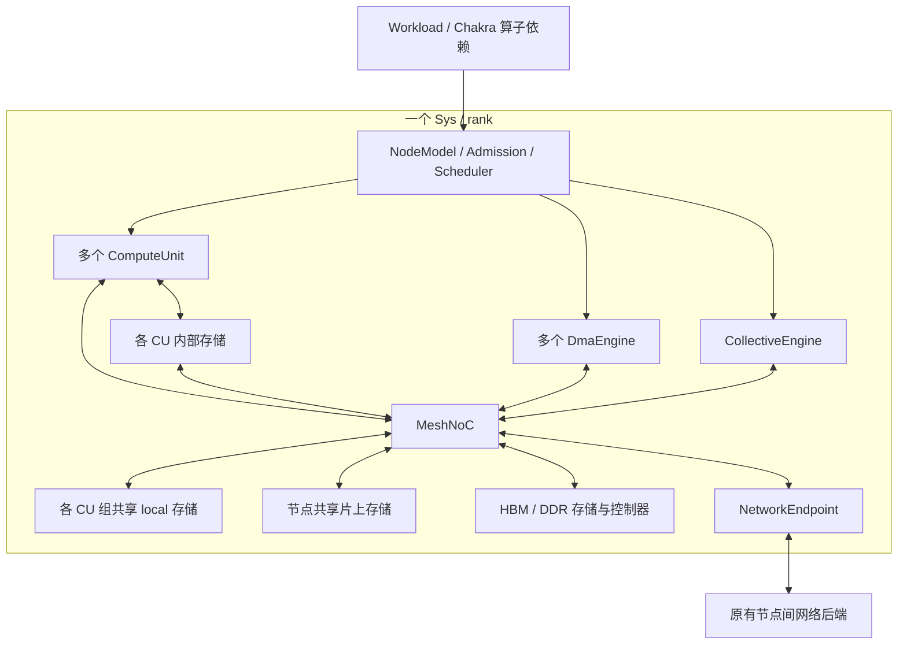

# 可配置的节点内多模块时序模型：实现规格

- 状态：**用户已批准实施；实现及运行说明见 [node-model.md](node-model.md)**。
- 日期：2026-11-11。
- 对照代码版本：`4ce9ecfe746a3ee5fe47559a11d91644d641fa7f`。
- 本文保留审阅通过的实现约定与验收要求；用户已授权实现，未发布环境。
- `NodeModel`、`NodeTopology` 等模块现位于 `astra-sim/node/`；实际支持范围与验证结果见运行说明。

## 1. 目标与保真度

在 ASTRA-sim 的一个 `Sys/rank` 内建模一颗加速器：多个计算单元能够并行执行算子，任意数量的显式管理存储实例提供容量和带宽约束，多个 DMA 与计算/通信共享片内 mesh，集合通信单元协调本地搬移、归约和对外收发。存储可以属于计算单元内部、由几个计算单元共享、由整颗加速器共享，或采用 HBM/DDR 等实现。

实现必须能够回答：算子为什么等待、实际占用了哪些资源、数据经过哪些模块、拥塞发生在哪里，以及这些状态怎样影响对外发包和最终完成时间。

首版采用**不执行真实数值运算的事务级离散事件时序模型**。计算、存储分配/数据位置、传输与资源竞争均有状态；不执行指令、不逐周期模拟完整微架构。NoC 使用分包的 store-and-forward 模型，重点估算 mesh 下共享链路、输出端口仲裁和有限缓冲造成的竞争，不要求周期精确或 wormhole/flit 精确模型。性能结果需用微基准校准后使用。

### 1.1 必须覆盖的六项能力

| ID | 需求 | 本规格中的实现 |
| --- | --- | --- |
| R1 | 多计算单元并行执行不同算子 | 多 CU 调度、算子内部阶段图、依赖与资源分别约束 |
| R2 | 多层显式存储，不同带宽和容量 | 任意数量 StorageModule：CU 内存储、组共享 local 存储、节点共享片上存储、HBM/DDR；显式分配/释放/搬移，超容量报错 |
| R3 | 多 DMA 数据搬移 | 独立描述符队列、多个未完成事务、源读与目的写完成语义 |
| R4 | mesh NoC 估算读写时延 | 端口挂载、XY 路由、请求/数据分包、共享链路、有限缓冲、背压 |
| R5 | 集合通信单元转换外部事件 | 复用已有算法步骤，加入本地搬移与归约，驱动现有 send/recv |
| R6 | 参数配置 | 版本化 JSON、单位明确、构造前校验、有效配置可导出 |

### 1.2 范围及审阅后的决策

1. **已确认：一个 rank 对应一颗加速器**；内部 CU、存储、DMA、router 不增加 rank。
2. 首个完整集成目标为 analytical congestion-aware 后端。节点内实现不依赖其私有 EventQueue 类型；其他后端在实际通过接入测试前不宣称支持 detailed 模式。
3. **按评论修正：不是一致性或非一致性缓存，而是显式管理的多层存储。** 不设两级/三级或固定实例数限制；每个存储实例独立配置容量、带宽、时延、端口与共享范围。
4. 数据由显式 allocate、copy、read/write 和 free 管理；没有自动命中/未命中、替换、回填或脏数据写回。搬入前检查目的分配和剩余容量，超容量立即报错，不能自动驱逐、溢出到其他存储或无限等待。
5. **已确认：提供/生成分块访存 profile。** 只有 FLOPs/总字节数的旧 ET 不足以决定具体数据位置和搬移，detailed 模式禁止静默编造。
6. **已确认：事务级 mesh 足够，重点是共享链路/总线冲突。** 保留 XY、仲裁、带宽串行化和有限缓冲，支持无竞争路径并行与共享路径竞争。
7. **已确认：首版使用 Ring 的 All-Reduce、Reduce-Scatter、All-Gather、All-to-All，以及专用集合通信单元局部归约。** 其他算法/操作必须通过支持矩阵校验，不能静默退化为固定延迟。
8. **已确认：首版只约束本地 NIC 缓冲，不承诺对外部网络的硬件 credit 背压。** 复用原网络接口形成事务级闭环，该后端扩展另列后续范围。
9. 不配置节点模型时保持 legacy 行为与现有测试参考输出。

## 2. 当前代码依据与改动位置

以下路径相对仓库根目录，描述的是基准版本的实际行为。

| 代码 | 当前行为 | 计划接入 |
| --- | --- | --- |
| `astra-sim/network_frontend/analytical/congestion_aware/main.cc` | 按 NPU 数创建 `Sys(i, ...)` 与 network handler | rank 映射保持；不创建内部模块 rank |
| `astra-sim/system/Sys.hh/.cc` | 持有 `Workload`、`comm_NI`、`remote_mem`、`MemBus` | 持有一个 `NodeModel`；在 `initialize_sys()` 解析新配置并构造 |
| `astra-sim/workload/Workload.cc` | 就绪算子经 `HardwareResource` 判断后 issue；计算使用 replay 或 Roofline | detailed 模式提交异步 NodeOperation；完成后统一解除 ET 依赖 |
| `astra-sim/workload/HardwareResource.hh/.cc` | CPU、GPU compute、GPU comm 各有单槽限制，recv 有例外；`num_npus` 未用于多核调度 | detailed 模式下不再用其 GPU 单槽限制节点内并发 |
| `astra-sim/system/Sys.cc` 的 `register_event/try_register_event` | 通过 `comm_NI->sim_schedule()` 接入后端时钟 | 节点内所有事件共用这一时间线 |
| `astra-sim/common/AstraNetworkAPI.hh` | `sim_send/recv/schedule` 与完成回调；send/recv 无本地 buffer 地址语义 | 作为外部网络传输接口，增加节点内上下文适配，保持旧虚函数签名 |
| `astra-sim/workload/Workload.cc` 的 `issue_coll_comm()` | 调用 `Sys::generate_*`，通过 DataSet 完成通知 Workload | detailed 模式由 CollectiveEngine 接管本地执行和最终通知 |
| `astra-sim/system/astraccl/native_collectives/collective_algorithm/Ring.cc` | 按算法生成 send/recv、使用 stream/tag/vnet | 保留算法配对，增加本地事务上下文 |
| `astra-sim/system/PacketBundle.cc`、`MemBus.cc`、`LogGP.cc` | 已有搬移、局部处理和部分带宽延迟 | detailed 模式替换对应本地阶段，禁止与新模型重复计时 |
| `astra-sim/common/AstraRemoteMemoryAPI.hh` | 只有 size 与回调上下文，面向远端扩展内存 | 保留远端路径；不能拿来直接承载本地多存储实例/分配/路由语义 |
| `astra-sim/workload/LocalMemUsageTracker.*` | 追踪张量生命周期和容量统计 | 保留原有统计职责；新增逐存储实例的实际占用与预留账本 |
| `astra-sim/common/AstraComputeAPI.*` | 有接口声明，当前 Workload 计算路径未调用 | 不依赖其作为已接好的节点接口；后续可做兼容适配 |
| 根 `CMakeLists.txt` | 文件列表未覆盖拟新增 `astra-sim/node/` 目录 | 显式加入新源文件/子目录和测试目标 |

## 3. 总体结构与所有权



- `Sys` 用唯一所有权持有 `NodeModel`；初始化晚于配置解析、早于 `Workload::fire()`。通过前置声明和 out-of-line 析构控制依赖。
- `NodeModel` 持有模块实例、调度器、事务表、外部网络适配和统计。
- `NodeTopology` 是只读结构描述：模块/端口身份、连接、mesh 坐标、挂载点。构造完成后冻结。
- `AddressMap` 解析显式存储引用 `(storage_id, buffer_id, offset)`，定位独立存储中的分配及物理偏移；不执行透明层级查找。
- 数据驻留/有效区间、容量预留、链路占用、队列和请求状态属于模块运行实例；不同 rank 绝不共享这些可变状态。
- 可共享只读拓扑描述；不能通过静态全局表把各 rank 的内部拥塞混在一起。
- 内部模块编号与 rank、ET node ID、communicator ID 分属不同命名空间。

拟新增文件职责：

```text
astra-sim/node/
  NodeModel.hh/.cc          对外提交、状态、完成通知
  NodeBuilder.hh/.cc        配置解析、实例化、连接与校验
  NodeTopology.hh/.cc       模块、端口、挂载和连接查询
  NodeEventScheduler.hh/.cc 同一全局时间线上的内部事件分派
  NodeOperation.hh          操作、阶段、事务及完成数据
  AddressMap.hh/.cc         显式存储/buffer 引用与存储内地址解析
  StorageAllocator.hh/.cc   每存储实例的分配、预留、释放和容量错误
  ComputeUnit.hh/.cc        计算资源及阶段执行
  StorageModule.hh/.cc      任意存储实例、读写端口、有效区间和服务队列
  DmaEngine.hh/.cc          搬移队列与窗口
  MeshNoC.hh/.cc            分包、路由、仲裁、链路和缓冲状态
  MemoryController.hh/.cc   HBM/DDR 存储的时序服务实现，共用其容量账本
  CollectiveEngine.hh/.cc   集合操作、本地归约及算法桥接
  NetworkEndpoint.hh/.cc    本地数据就绪与外部 send/recv 桥接
  NodeStatistics.hh/.cc     时序、利用率、拥塞和逐存储占用统计
```

文件可按实现粒度合并，但上述职责与所有权约定不变。

## 4. 节点拓扑：配置与运行时表示

### 4.1 配置入口与兼容

system JSON 新增唯一入口：

```json
{
  "node-model-config": "../node/mesh-node.json"
}
```

- 无该字段：legacy。字段存在：detailed；路径相对 **system 配置文件目录**解析，不依赖启动工作目录。
- 节点文件中的 profile 路径相对节点文件目录解析。
- detailed 模式与 `replay_only`、`roofline-enabled != 0` 冲突时启动失败；避免同一算子被两套模型计时。
- detailed 的带宽不继承 legacy `local-mem-bw`；旧 MemBus 参数不参与已替换阶段。
- 本阶段所有 rank 采用同一种节点配置；异构 rank 配置不在首版范围。

### 4.2 单位和模式

- 时间为整数 ns，字节为 B，带宽为 `bytes_per_ns`，算力为 `ops_per_ns`；SI 单位换算只发生一次。
- 服务时间按 `ceil(bytes / bandwidth)`、`ceil(ops / throughput)` 计算；禁止向下截断成零或整数溢出。
- 所有正数限制、可为零的延迟、地址端点及对齐规则必须在配置 schema 中定义。
- 数值采用 `uint64_t` 表示字节、时间、地址和累计计数；速率可使用有限正浮点数。禁止 NaN/Inf。


### 4.3 节点配置示例

下面是首版配置结构的规范样例；具体数值仅用于演示，不代表已校准硬件。`storages` 为可变长数组，同一种 scope 可有任意多个实例，没有硬编码的层数或数量上限；仅受宿主资源与 ID 表示范围限制。`sram/hbm/ddr` 选择服务参数，不触发自动数据迁移。

```json
{
  "schema_version": 1,
  "admission_capacity": 64,
  "cpu": {"slots": 1},
  "compute_units": [
    {"id": "cu0", "kind": "tensor", "ops_per_ns": 1024, "startup_ns": 2, "local_storage": "cu_mem0"},
    {"id": "cu1", "kind": "tensor", "ops_per_ns": 1024, "startup_ns": 2, "local_storage": "cu_mem1"}
  ],
  "storages": [
    {"id": "cu_mem0", "kind": "sram", "scope": "cu_private", "clients": ["cu0"], "capacity_bytes": 65536, "bytes_per_ns": 64, "access_latency_ns": 2, "queue_entries": 16},
    {"id": "cu_mem1", "kind": "sram", "scope": "cu_private", "clients": ["cu1"], "capacity_bytes": 65536, "bytes_per_ns": 64, "access_latency_ns": 2, "queue_entries": 16},
    {"id": "local0", "kind": "sram", "scope": "group_local", "clients": ["cu0", "cu1"], "capacity_bytes": 524288, "bytes_per_ns": 32, "access_latency_ns": 5, "queue_entries": 32},
    {"id": "shared0", "kind": "sram", "scope": "node_shared", "clients": ["*"], "capacity_bytes": 2097152, "bytes_per_ns": 64, "access_latency_ns": 8, "queue_entries": 32},
    {"id": "hbm0", "kind": "hbm", "scope": "node_shared", "clients": ["*"], "capacity_bytes": 1073741824, "bytes_per_ns": 128, "access_latency_ns": 80, "queue_entries": 32},
    {"id": "ddr0", "kind": "ddr", "scope": "node_shared", "clients": ["*"], "capacity_bytes": 2147483648, "bytes_per_ns": 32, "access_latency_ns": 120, "queue_entries": 32}
  ],
  "dma_engines": [
    {"id": "dma0", "queue_entries": 16, "max_outstanding": 8, "burst_bytes": 256, "bytes_per_ns": 32, "startup_ns": 4},
    {"id": "dma1", "queue_entries": 16, "max_outstanding": 8, "burst_bytes": 256, "bytes_per_ns": 32, "startup_ns": 4}
  ],
  "collective_engine": {"id": "coll0", "slots": 1, "queue_entries": 16, "startup_ns": 4, "reduce_bytes_per_ns": 32},
  "network_endpoint": {"id": "nic0", "tx_buffer_bytes": 1048576, "rx_buffer_bytes": 1048576, "bytes_per_ns": 64, "startup_ns": 2},
  "noc": {
    "rows": 2, "columns": 2, "routing": "xy", "packet_payload_bytes": 64,
    "header_bytes": 16, "link_bytes_per_ns": 32, "link_latency_ns": 1,
    "router_latency_ns": 1, "input_buffer_packets_per_class": 8,
    "attachments": [
      {"port": "cu0.fabric", "router": [0, 0]},
      {"port": "cu1.fabric", "router": [1, 0]},
      {"port": "cu_mem0.fabric", "router": [0, 0]},
      {"port": "cu_mem1.fabric", "router": [1, 0]},
      {"port": "local0.fabric", "router": [0, 1]},
      {"port": "shared0.fabric", "router": [1, 1]},
      {"port": "hbm0.fabric", "router": [1, 1]},
      {"port": "ddr0.fabric", "router": [1, 1]},
      {"port": "dma0.fabric", "router": [0, 0]},
      {"port": "dma1.fabric", "router": [1, 0]},
      {"port": "coll0.fabric", "router": [0, 1]},
      {"port": "nic0.fabric", "router": [0, 1]}
    ]
  },
  "direct_links": [
    {"a": "cu0.mem", "b": "cu_mem0.local", "bytes_per_ns": 64, "latency_ns": 1},
    {"a": "cu1.mem", "b": "cu_mem1.local", "bytes_per_ns": 64, "latency_ns": 1}
  ],
  "operation_profiles": "mesh-node-profiles.json"
}
```

### 4.4 连接与存储定位的精确定义

- 模块端口按类型固定：CU 的 `mem/fabric`，存储的 `local/fabric`，DMA/集合通信/NIC 的 `fabric`。私有存储可同时接受其 CU 的直连访问及 DMA 的 NoC 搬移；两入口共享同一容量账本与服务端口。
- `local_storage` 是 CU 的内部存储绑定，不代表该 CU 的请求都必须经过该存储。访问其他显式存储时使用 CU 的 fabric 端口；访问自身 local_storage 时使用已配置直连。无可达物理路径时失败，不自动转移到其他层。
- `scope/clients` 表示逻辑共享范围，与物理连通性分开校验：cu_private 的 clients 恰好一个 CU，group_local 为显式 CU 列表，node_shared 为 `[*]`。DMA 代表明确 requester 执行，不能靠自身物理连通性越过该 requester 的权限。集合通信单元/NIC 首版直接使用 node_shared 存储；涉及私有/组共享数据时由 profile 先做显式搬移。
- `direct_links` 表示两条独立占用的有向链路，支持全双工；每方向有速率、传播时延和有限目的缓冲。首版目的端口固定 8 packet/流量类别，作为 schema 默认值导出。
- mesh 自动生成相邻 router 间的双向连接；每方向独立，XY 为先 x/column 后 y/row。
- `attachments` 将端点接入 router 的独立 local port；同一 router 可挂载多个端点，不代表共享一个无限带宽端口。local link 使用 NoC 配置中的链路参数。
- 一个端口只能绑定一次。CU 到内部存储的直连与两者到 NoC 的挂载是不同端口。
- 每个持久 buffer 的位置为 `(rank, storage_id, buffer_id, generation)`；offset 为相对 buffer 的字节偏移，实际存储内地址由分配表解析。同一数值 offset 在不同存储中表示不同物理位置。
- 一个逻辑 tensor 可在多个存储有独立副本；copy 建立指定版本的目的副本，源后续写入不自动更新目的。消费哪个版本由 profile 的显式位置与依赖确定。
- 请求目标由显式 storage_id 决定，再由拓扑选择直连或 NoC 路径；不存在 home L2、统一 cache line、`next_level` 或 miss 后的自动向下查询。
- 请求跨 burst/packet 边界时拆分，完整请求在所有子事务完成后结束。首版每个 buffer 属于一个存储实例，不做隐式跨存储条带化；需要条带化时由 profile 显式生成多个 buffer/搬移阶段。

### 4.5 运行时结构与校验

`NodeTopology` 至少保存 ModuleId、PortId、RouterId、LinkId 及其索引、端口连接表、挂载表、存储 scope/clients 和只读参数。`NodeBuilder` 完成命名解析后，运行时不依赖字符串反复查找。

启动前必须校验：schema 版本、未知字段、重复 ID、端口方向/协议兼容、重复连接、挂载坐标、资源正数、CU/local_storage 绑定和共享范围、profile 引用、所需端点可达、buffer 是否容纳至少一个 packet、NoC/外部后端支持范围。错误必须带配置路径和字段定位。不再校验缓存行/路数/MSHR，也不按两级或固定数量限制存储实例。

初始分配在启动时校验，动态 allocate/copy 在执行前校验实际分配状态及容量。物理 mesh 本身有环是合法的；拓扑合法不保证工作负载无死锁，运行时仍需无进展诊断。

## 5. 对外接口、事务和事件契约

### 5.1 NodeModel 的最小接口

以下为语义约定，类型签名可适应项目 C++17 风格：

```cpp
SubmitResult try_submit(const NodeOperation&, OperationObserver&);
bool idle() const;
void dump_statistics(...);
```

- `SubmitResult` 区分 Accepted、WouldBlock、Invalid。Invalid 是终止错误，不参与反复重试。
- Accepted 后节点模型复制/持有操作描述；调用方可释放输入对象。WouldBlock 不产生任何状态或回调。
- observer 提供 `on_started(op_id, tick)`、`on_completed(op_id, result)` 和 admission 可重试通知。Accepted 不在调用栈内同步回调。
- 每个已接收操作恰好完成一次；失败不能当成成功释放后继依赖。
- 提交返回值不包含预先确定的完成用时。完成时的时间戳与统计是仿真结果。
- observer/回调上下文由所有者保证生命周期；禁止捕获会提前析构的 ET 临时引用。

### 5.2 标识与请求内容

- OperationId 在 rank 内唯一，对应 ET node ID；内部 TransactionId/PacketId 独立递增。
- 内存事务携带 op/txn/parent ID、请求者、storage_id、buffer_id/generation、offset、长度、Read/Write 与返回端点；allocate/free 由容量管理器处理，不伪装成网络数据传输。
- DMA 携带源/目的 BufferRef、requester、长度、可选引擎绑定；集合通信携带 communicator、操作、逻辑实例、输入/输出存储与 buffer、offset/length 和分块上下文。
- 模拟的是数据标识和时序，不携带真实 tensor 数值。读写和归约的字节数、位置与依赖仍必须守恒。
- 事务拆分/合并必须保留 parent 与完成计数，禁止把一个到达的 packet 当成整个算子完成。

### 5.3 同一时间线

- 内部事件经 `NodeEventScheduler` 调用 `Sys::register_event()`，最终仍由既有 `sim_schedule()` 驱动。
- 不创建独立墙钟线程，不自行运行到算子结束，不把一个完整节点预跑后再返还总延迟。
- scheduler 维护稳定递增序号；同 tick 按资源释放、到达处理、仲裁/派发、上层通知的固定顺序处理。同 tick 新增事件进入下一内部 delta 轮，不递归执行 observer。
- 不因调度方便无条件增加 1 ns；零时延使用 delta 轮。必须审计 `Sys::call_events()` 同 tick 插入/清理语义，避免丢事件、迭代失效和重复 pump。
- 每个 rank 同一时间戳最多挂一个有效内部 pump；全局跨 rank 排序遵循所选后端，不依赖未定义的线程/容器遍历顺序。
- 固定输入应产生可重复的派发与事件轨迹；随机策略不属于首版。

## 6. 调度、工作负载输入与完成语义

### 6.1 Workload 接入

1. `Workload` 仍是 ET 依赖关系的唯一管理者。
2. 对就绪节点先尝试原子 admission；Accepted 后才 `take_node()`，登记 outstanding，并记录 enqueue 时间。
3. detailed 模式将 GPU compute/comm/本地 memory 的资源调度交给 NodeModel，不再调用旧单槽 occupy/release。legacy 分支保持原行为。
4. CPU 节点进入单独的 replay 队列，首版一个 slot，时间按 ET runtime；不能伪装成 NPU CU 或使用其 Roofline。
5. admission 腾出空间必须通知 Workload 重试，不依赖某个无关算子偶然完成；重复通知合并，防止递归 issue。
6. 实际首阶段开始触发 started；全部必要阶段与目标数据可见后触发 completed，Workload 才 `finish_node()` 并重试后继。
7. 完成条件包含 ET 无 ready/ongoing、NodeModel idle、无外部未完成请求、无在途搬移/响应/回调遗留。仍分配的有效 buffer 不等于未完成事务，不要求运行结束把全部数据搬回 HBM/DDR。不能只检查旧 HardwareResource 计数。


### 6.2 ET 扩展与 profile

不修改 Chakra protobuf schema；使用现有 attr 增加一个字符串 `node_model_profile`，指向节点配置加载的 profile 表中的条目。用户已确认可提供或生成分块访存 profile。

- detailed 模式所有实际执行的 compute、memory、send/recv、collective 节点都需要 profile。CPU replay 和已支持的 metadata 是例外。
- compute profile 描述 CU kind、可选固定 CU、操作的内部阶段图。MEM_LOAD/MEM_STORE profile 必须明确 `local_dma/remote_memory`；不能改变旧 ET 的含义。
- remote_memory 继续调用现有 remote_mem，通过完成回调连接到本地 buffer；远端仍是原 analytical 模型，不宣称与本地 NoC 同等级保真度。
- 每阶段有唯一 ID、显式 deps 及 kind：`allocate`、`free`、`read`、`compute`、`write`、`dma_copy`。没有 flush/invalidate，也不因读取缺少数据自动搬移。
- allocate 给出 storage、buffer_id、bytes、alignment（默认 1）；可选固定 storage_offset，否则按确定性 first-fit 分配。free 给出完整存储/buffer 引用。
- read/write 使用 BufferRef：`{storage, buffer_id, generation, offset, bytes}`；compute 给出 ops；dma_copy 给出 source/destination BufferRef、requester 及可选 dma_id。绑定 CU 的 profile 可使用 `$cu.local_storage`，派发时解析为该 CU 的存储 ID；其 requester 默认为所绑定 CU。
- 一次 compute 操作首版固定在一个 CU 上，其阶段不跨 CU 迁移。同类型空闲 CU 按 ID 稳定选择；多个操作可以占不同 CU。一个算子跨多 CU 分解留给后续扩展。
- 操作绑定 CU 后直到最后阶段完成都持有该 CU；数据等待算作该 CU stall。双缓冲/计算搬移重叠通过不同 tile 的阶段依赖表达。
- 阶段的请求数受未完成窗口、DMA 窗口及队列限制，禁止一次展开无限请求。profile 必须无环、BufferRef 合法、依赖引用完整。
- BufferId 在一个 rank 内唯一；释放后复用 ID 时 generation 增加，旧引用报错。allocate/free 不隐含 DMA，copy 不隐含 free；各动作必须明确出现在阶段图中。
- 张量形状/IOInfo 可由独立转换工具生成 profile，不从总 tensor_size 猜测访问序列、存储位置或数据生命周期。固定 runtime replay 仅在 legacy 模式使用。

profile kind 的必需字段：

| profile kind | 适用 ET 类型 | 必需字段 |
| --- | --- | --- |
| `compute` | COMP_NODE，非 CPU | `cu_kind`、`stages`；可选 `cu_id` |
| `local_dma` | MEM_LOAD_NODE / MEM_STORE_NODE | 已分配的 source/destination BufferRef、requester；长度相等；可选 dma_id |
| `remote_memory` | MEM_LOAD_NODE / MEM_STORE_NODE | remote_bytes 与 ET tensor_size 一致、已分配 local_buffer；LOAD 预检目的容量后请求远端，完成后本地写入；STORE 本地读完成后请求远端 |
| `send` | COMM_SEND_NODE | 已初始化 buffer、instance_id；peer/tag/长度由 ET 给出并校验 |
| `recv` | COMM_RECV_NODE | 已分配 buffer、instance_id；peer/tag/长度由 ET 给出并校验 |
| `collective` | COMM_COLL_NODE | input/output BufferRef、instance_id、elem_bytes、operation 和有序参与 rank；与 ET/comm_group 校验 |

`instance_id` 是参与 rank 一致的逻辑通信实例，不是各自任意分配的本地计数。首版 send/recv/collective 的 buffer 位于配置可达的 node_shared 存储，已确认需要通过专用集合通信单元执行局部归约。

All-Reduce/All-to-All 的 input/output 字节数相等；All-Gather 的 output 为 input×组大小；Reduce-Scatter 的 input 为 output×组大小。首版支持等长分块，长度须整除分块数及 elem_bytes。目的完整 buffer 必须已分配，不能因为流式处理就忽略其容量。首版 collective 不支持重叠的输入/输出，DMA 不支持同一存储中重叠范围的 memmove 语义。

示例明确执行 HBM → CU 内存储 → 计算 → 节点共享存储。初始 buffer 使用 allocator 固定预留容量，`initialized: true` 表示初始数据有效；非初始化分配不允许读。示例仅表达时序，不存储实际数值。

```json
{
  "schema_version": 1,
  "initial_buffers": [
    {"storage": "hbm0", "buffer_id": "input", "generation": 0, "bytes": 1024, "initialized": true},
    {"storage": "shared0", "buffer_id": "output", "generation": 0, "bytes": 1024, "initialized": false}
  ],
  "profiles": {
    "tile_op": {
      "kind": "compute", "cu_kind": "tensor", "cu_id": "cu0",
      "stages": [
        {"id": "alloc", "kind": "allocate", "storage": "$cu.local_storage", "buffer_id": "tile", "generation": 0, "bytes": 1024, "deps": []},
        {"id": "load", "kind": "dma_copy", "source": {"storage": "hbm0", "buffer_id": "input", "generation": 0, "offset": 0, "bytes": 1024}, "destination": {"storage": "$cu.local_storage", "buffer_id": "tile", "generation": 0, "offset": 0, "bytes": 1024}, "deps": ["alloc"]},
        {"id": "read", "kind": "read", "buffer": {"storage": "$cu.local_storage", "buffer_id": "tile", "generation": 0, "offset": 0, "bytes": 1024}, "deps": ["load"]},
        {"id": "calc", "kind": "compute", "ops": 65536, "deps": ["read"]},
        {"id": "write", "kind": "write", "buffer": {"storage": "$cu.local_storage", "buffer_id": "tile", "generation": 0, "offset": 0, "bytes": 1024}, "deps": ["calc"]},
        {"id": "store", "kind": "dma_copy", "source": {"storage": "$cu.local_storage", "buffer_id": "tile", "generation": 0, "offset": 0, "bytes": 1024}, "destination": {"storage": "shared0", "buffer_id": "output", "generation": 0, "offset": 0, "bytes": 1024}, "deps": ["write"]},
        {"id": "free", "kind": "free", "storage": "$cu.local_storage", "buffer_id": "tile", "generation": 0, "deps": ["store"]}
      ]
    }
  }
}
```

initial_buffers 可放在任意显式存储中，并非默认都在 HBM。它们占用对应实例容量，直到显式 free；操作完成不自动释放其存储。profile 重复使用时需用唯一 buffer_id/generation，不能把示例的 tile 原样并发重复分配。

## 7. 各子模块行为

### 7.1 ComputeUnit

- 每 CU 首版一个 operation slot，内部 compute pipeline 一个服务 slot；内存请求可在窗口允许时并行。
- compute 服务时间为 `startup_ns + ceil(ops / ops_per_ns)`；startup 每 compute 阶段一次，不能在每 packet 重复收取。
- 使用阶段化访存后，不再额外叠加原 Roofline 的总访存时间。CU 算力配置为每 CU 值，不能让每 CU 继承整节点峰值。
- 固定 CU 不存在、kind 不匹配或无法满足的永久需求在启动/提交时失败，不得无限排队。


### 7.2 StorageModule 与容量分配

**这些模块是存储，不是缓存。** 每个存储独立拥有容量、读写端口、延迟、请求队列、allocation 表和数据有效区间。cu_private/group_local/node_shared 为共享范围，不限制技术类型或实例数量。

- StorageAllocator 以存储为单位维护 allocation/generation、已分配区间、在途预留、读写引用和释放状态；容量只扣一次。HBM/DDR 控制器服务同一实例，不重复计算容量或带宽。
- allocate 以整个 buffer 大小原子预留容量，未写入或正在搬入的数据同样占用容量。对齐/实际分配 padding 计入占用，不能到最后一个 packet 到达才扣容量。
- 不带固定 offset 时使用按地址升序的 first-fit；带 offset 时必须在容量范围内且不与已有分配重叠。碎片导致无连续范围也需报错，不能用总剩余字节掩盖。
- 初始数据、运行时分配、CU/DMA/通信目的及工作区都进入同一账本。每实例必须满足 `allocated_or_reserved_bytes <= capacity_bytes`，按唯一 allocation 求和，不能将 reserved 和 allocated 对同一 buffer 重复累计。
- 容量不足为 **CapacityExceeded 终止错误**，不是 WouldBlock。报告 rank、op/phase、storage_id、容量、占用/预留、请求量、可用量及活跃 buffer；无连续范围额外标明碎片原因。不得自动驱逐、搬到 HBM/DDR、缩小搬移、复用活跃区间或等待其他操作将来释放。
- DMA/read/write/recv/collective 发起前，必须验证目的分配已存在、大小与 offset 正确且尚未释放。未分配目的、超出分配范围分别为 AllocationMissing/BufferBounds 错误；即使存储仍有空闲空间也不能静默扩容。
- allocate 成功、内容未写完的区间处于 Reserved/Pending；目标整个 parent 写入/搬移范围完成后才变为 Valid。源读必须覆盖于有效数据区间；缺数据直接报 DataUnavailable，不触发隐式搬移。
- 已有分配范围内的合法覆盖写不增加容量；先完成相关读写再更新该范围版本。不同存储中同一逻辑 tensor 的副本各占其所在存储容量。
- free 必须显式执行，且 buffer 没有在途引用；profile 应将其依赖于全部使用者。存在在途访问时报告 BufferInUse，不提前回收。copy 默认保留源；要模拟 move，必须显式 `copy → free(source)`。
- 对同 buffer 的并发只读允许；重叠写/读写由存储请求接收顺序串行化，profile 应用依赖表达所需数据版本，模型不提供隐式跨操作同步。共享同一存储的消费者在对应写完成后读取；跨存储可见性仅由显式 copy 和完成依赖建立。
- 动态 allocate 同 tick 按稳定事件序号执行，防止多个 DMA/算子各自看到足够空闲而超额承诺。后续失败导致仿真终止时输出账本，不对已发出的外部事件做伪回滚。
- 存储数据端口首版读写共享带宽、FCFS，可流水访问。请求到达 t、端口可用 p：服务起点 `max(t+access_latency_ns, p)`，完成为起点加 `ceil(bytes/bytes_per_ns)`。多个实例独立服务，共享 NoC 链路仍有竞争。
- 请求队列暂满属于可恢复背压，与持久容量不足严格区分。队列项服务完成后释放；buffer 容量只由显式 free 释放。

容量例子：一个 64 KiB 存储已有 48 KiB 活跃/预留分配，再申请 32 KiB 搬入区必须报错；若先显式 free 旧区且依赖确保先完成，后续 allocate 才可成功。两个并发 40 KiB 分配不能同时在 64 KiB 存储中成功。

### 7.3 DmaEngine

- FIFO 描述符调度；未绑定的请求选择最先空闲引擎，同 tick 按 ID。引擎数与队列/未完成窗口分别生效。
- 一次描述符支付一次 startup；按 burst、buffer 范围和 NoC packet 边界拆为子请求，不引入 cache line 对齐要求。
- 每个 burst 先读到引擎 staging，再发目的写；描述符在全部目的写达到目标空间的完成点后完成，不能在发出最后一个读请求时完成。
- staging 容量为 `max_outstanding * burst_bytes`，必须检查乘法溢出；窗口满后停止发起新 burst。
- 引擎的吞吐上限与 NoC/各存储端口限制共同作用。字节沿路径分别消耗对应资源，禁止给 DMA 额外独占一份 HBM/DDR 带宽。
- 第一笔源读发起前，验证整个源数据有效、目的 buffer 已分配且足够大，并固定两端 generation、取得在途引用；不得搬到一半才发现容量不足。动态 allocate 若是前置阶段，必须在这里之前原子完成。
- 首版不支持同一存储中重叠源/目的范围的 memmove 语义，提交时拒绝；不同存储相同 offset 不算重叠。不支持无界 descriptor。

### 7.4 MeshNoC 与链路

- packet 以完整包存储转发，payload 不超过配置，末包按真实字节计费；header 单独占带宽。读请求通常仅 header，读响应/写请求携带数据，写完成另有 header ACK。
- 控制请求（Read 请求及 Write ACK）与载荷数据（Read 响应及 Write 数据）使用分离的虚拟网络/缓冲队列，共享物理链路带宽；没有缓存写回流量类别。首版不做自适应路由。
- 每 router 输出采用 round-robin 仲裁，每输入/类别 FCFS；稳定 ID 决定初始轮转位置。请求必须等到下一跳缓冲 credit 与链路均可用才出发。
- 下游无 credit 时保持在输入队列，不占有物理链路；发包时预留下游 buffer，完整到达后才可继续下一跳。
- 单跳时延为 `router_latency_ns + ceil(wire_bytes/link_bytes_per_ns) + link_latency_ns`。传播/路由部分不延长已经结束的链路序列化占用；端点注入/弹出链路也计费。
- 本级流控必须向 DMA/CU/存储服务队列传播等待，不能通过无界旁路队列规避缓冲限制。只争用同一有向链路/输出端口的流量才发生对应竞争；不把整个 mesh 退化为一个全局总线锁。
- 接收端必须保留处理响应/ACK 的前进路径，不能持有请求输入缓冲等待自己尚未接收的响应；实现需要给出资源依赖顺序及压力测试。仅有 XY 路由不等于整个存储协议自动无死锁。
- 在全局仿真已静止、仍有未完成操作且无可推进事务时，输出阻塞事务、资源占有和等待链并失败；不将事件队列空误判为成功。某个 rank 的内部队列为空、但仍在等待有效的外部未来事件时，不能误报死锁。后端需在全局结束检查中调用各 NodeModel 的诊断/idle 检查。


### 7.5 HBM/DDR 的 MemoryController

- HBM/DDR 也是 `storages` 的实例，与 CU 内存储、group_local、片上共享存储使用同一分配/容量/完成契约。技术差异由容量、带宽、时延及服务策略表示。
- 首版每实例由一个控制器按 §7.2 的 FCFS/流水端口公式服务；读写共享带宽，无 DRAM bank/row-buffer 模型。StorageModule 与控制器不能各收一次相同服务时延。
- 队列满向上游背压；写 ACK 在目的服务完成后发出。数据读响应和写 ACK 还要经过真实的 NoC/直连回程。
- 任意多个 HBM/DDR 存储可独立配置，请求必须指定实际 storage_id；不存在自动溢出或“上层缺数据就去 HBM”的规则。
- 禁止叠加 legacy remote_mem 的延迟作为本地 HBM/DDR 延迟；两者是不同建模对象。

## 8. 集合通信与外部网络

### 8.1 算法复用与本地执行

`CollectiveEngine` 接收一个 collective profile：op、communicator、逻辑实例 ID、输入/输出 BufferRef、长度、dtype/elem_bytes、可选 DMA 绑定。输入、输出和显式工作区均指定实际存储并计入其容量；提交前验证分配/输入有效性。ET 的 comm_type/comm_size 与 profile 不一致时失败。

- 第一阶段复用现有 `generate_*` 和 Ring 消息配对/stream 调度；不是另写一套互不一致的 Ring。
- 实现使用 `Sys::generate_collective` 和覆盖 communicator 的显式扁平 RingTopology，沿用已有 Ring/stream 与分块机制；详细模式不使用 legacy 分维调度或小块数据量扩张。当前已接入后端自身仅支持一维外网，与节点内二维 mesh 是独立的限制。
- 将算法的读取、局部归约、发送、接收和写入转换为 NodeModel 内部阶段；每一块拥有 operation/round/chunk/offset 上下文。
- 分块沿用原算法的 message 粒度与 system 配置中的分块决策。不能在网络适配器中私自重新分块而不更新 tag、offset、计数和配对。
- 本地归约使用 coll0 的专用归约 slot；服务时间为 `ceil(bytes/reduce_bytes_per_ns)`，输入读和输出写另走显式存储/NoC。它不同时占用 CU，除非未来明确配置为 CU 归约实现。
- 专用归约模型与旧 PacketBundle/LogGP 本地处理延迟互斥；首版详细模式关闭被替代的旧处理路径，而非简单再加一层延迟。
- broadcast、Tree、HalvingDoubling、自定义 collective 在未完成本地阶段适配前，detailed 模式启动即拒绝。legacy 模式不受限制。

### 8.2 算法上下文不能缺失

现有 send/recv 的 `dummy_data`、count、tag 不携带真实本地 buffer 地址。实现必须沿以下路径显式传播不可变 TransferContext：

```text
ET collective → CollectiveEngine → DataSet / stream / algorithm step
             → round/chunk/offset/peer/context
             → NetworkEndpoint → 原始 AstraNetworkAPI
```

TransferContext 不通过猜测 tag 恢复，不使用进程级“当前 collective”变量；支持至少两组不相交 communicator 各自推进。首版同一 communicator 内 collective 按各 rank 一致的提交顺序执行，实例 ID 与 tag 不能冲突。

### 8.3 收发及上层完成点

发送流程：

```text
显式源存储数据有效 → 存储读取/DMA → NoC → NIC TX staging
           → 向原始 sim_send 提交 → 后端发送完成回调 → 回到算法
```

接收流程：

```text
预留 NIC RX staging → 提交原始 sim_recv
 → 后端匹配/到达回调 → 本地 NoC/目的写/必要归约
 → 数据达到算法所需可见点 → 通知算法推进
```

- NIC buffer 按原算法一个 message 预留；message 大于容量时在构造/支持校验阶段报错，不能永远等待无法满足的空间。持久目标存储的完整输出区须在收包前分配并校验，即使 NIC staging 能容纳 message，也不能绕过最终目的容量检查。后续支持流式消息需单独扩展分块协议。
- 网络接口吞吐是 NIC 本地端口限制，与外部链路串行化分别计费；不能把同一外部链路带宽重复扣两次。
- 保持原始后端的发送完成语义，不将其解释为远端数据已经可见。远端可见性由接收链路独立确认。
- 先拿到 DataSet 网络完成通知不等于 ET 算子完成；CollectiveEngine 等待全部本地写入/归约完成，再向 Workload 恰好完成一次。
- 直接点对点 COMM_SEND/RECV 也走同一 NetworkEndpoint，避免绕过本地资源。
- 第一版 NIC 预留与 delayed receive 仅约束本地事务的提交/消费。某些后端可能在接收未提交时已经传输或暂存数据；因此不能据此宣称外部网络具有物理 RX buffer 背压。端到端 credit 需要扩展后端契约并另行验证。

### 8.4 对外可观察行为

| 观察者 | 可观察内容 |
| --- | --- |
| Workload | 接受/等待、实际开始、完成时间与错误 |
| 外部网络后端 | 发包时间、src/dst rank、tag、字节数、消息顺序与回调 |
| 统计/调试工具 | 内部 CU、各存储分配/读写、DMA、router/link 事件与等待原因 |

内部 router/storage ID 不进入外部 rank 空间。节点内拥塞通过发送节奏和完成时间影响整个系统；网络回调又能改变节点内下一步，形成因果闭环。不能仅在 collective 结束后附加一个内部总延迟。

## 9. 统计、诊断与兼容

- 每操作至少输出 enqueue/start/end、admission_wait、CU_wait、compute_busy、memory_stall、DMA_wait、NoC_wait、external_network_wait。允许重叠的类别必须声明，不能简单相加当作 wall time。
- 输出每 CU 利用率、DMA 字节/队列/窗口、每存储容量/当前与峰值占用/预留/分配释放/读写字节/端口利用率/队列等待、各 link 字节/忙碌时间/队列峰值、NIC staging 峰值。容量错误输出详细分配账本，不输出 cache hit/miss/MSHR 等无对应语义的指标。
- detailed 模式重新定义并命名节点 compute busy 的时间区间并集；旧 `curr_tick - tics_gpu_ops` 在并行算子下不能作为 exposed communication。没有严格因果归因时不输出伪精确的 exposed communication 指标。
- 事务轨迹可选启用，至少记录 rank/op/txn/parent/module/port/event/tick/bytes/storage_id/buffer_id/generation/offset；可按 op/rank 过滤，默认不开全量 packet 日志。
- 导出解析后的有效配置，包括默认参数、支持矩阵、模型保真度、配置版本与单位，便于重复实验。
- 可通过节点配置 `trace: {"enabled": true, "max_events": 10000}` 启用有界事务追踪；超出上限明确记录 truncated。等待指标按请求/packet 累计，可重叠，不是可相加的 wall-time 分解。
- 析构时检查 outstanding、在途搬移/存储引用、内部事件和外部请求引用；事件未排空前模块不可析构。报告仍存在的分配，区分预期存活输出与实际未完成请求。新增 CallData 的派生对象按确切类型销毁，不假定当前非虚基类析构可安全 delete。
- 未设置入口字段时，不改变既有模型选择、调度、trace 格式或回归参考文件。detailed 模式不支持的后端/配置应立即报错。

## 10. 测试与验收标准

所有时间预期均由小规模手算/独立参考脚本建立，不调用被测模型本身计算 expected。精确匹配适用于规范公式；较复杂争用场景验证顺序、守恒、单调关系及给定稳定轨迹，不仅验证退出码。

| 编号 | 场景 | 必须满足的结果 |
| --- | --- | --- |
| T01 | legacy 关闭新模型 | `tests/rt_template/run.sh` 与参考 stdout 一致；原 analytical 两个示例成功 |
| T02 | 拓扑构造与坏配置 | 正确实例数/可达性；重复端口、未知 ID、非法坐标、错单位/容量/映射有定位错误 |
| T03 | 单 CU、两个无依赖纯 compute | 按规则串行，完成时间等于两次服务之和；不重复完成 |
| T04 | 双 CU、两个独立纯 compute | 同 tick 启动；总时长为较长服务时间，而非之和 |
| T05 | 双 CU、有 ET 依赖 | 后继在前驱完成/数据可见前不能开始；有界 admission 满后可以恢复 |
| T06 | 任意数量存储、容量与显式搬移 | 配置超过四层/六实例、两组 group_local、HBM+DDR 均可用；每实例容量/带宽独立；读取未搬入数据报错，无自动下层读取/替换；64 KiB 中 48+32 KiB 分配报错，合法覆盖写不重复扣容量 |
| T07 | 预留、释放、并发与容量错误 | 两个并发 40 KiB 分配在 64 KiB 中不能同时成功；在途数据占容量；free 后可重用；过早 free/旧 generation/越界/碎片明确报错；队列背压可恢复，容量错误非 WouldBlock |
| T08 | 双 DMA | 独立路径可重叠；共享瓶颈有竞争；描述符等到目的写完成才结束 |
| T09 | 单 packet NoC | 0/1/多 hop 与 header/末包字节按链路公式手算一致；local link 计费 |
| T10 | NoC 竞争/全双工/有限缓冲 | 同方向共享链路串行；反方向独立；credit 用尽有上游等待并恢复，无丢包 |
| T11 | 显式存储读写 round trip | 读请求、响应、写数据、ACK 完整，目的范围在 parent 完成后有效；只计单向到达不能通过；跨存储副本不自动同步，组共享访问权限正确 |
| T12 | 多存储/控制器服务 | 同一实例直连/NoC 入口共享带宽，独立实例可并行；HBM/DDR 使用同一容量账本无双重计时；队列满背压；目的不足在发起第一笔源读/外部接收前报错 |
| T13 | 2/4 rank Ring All-Reduce | rank/tag/块数与算法一致；完成等到本地归约/写入；每块字节守恒 |
| T14 | Ring RS/AG/A2A | 每种实际执行；正确处理对应分块与本地数据范围；不能只运行 All-Reduce 代表全部 |
| T15 | 内外双向影响 | 降低本地共享链路带宽改变外部发送时序；外部到达延后使本地后继延后；collective/recv 输出超容量明确报错 |
| T16 | 同时计算/DMA/collective | 争用同一 memory/NoC 时出现共享瓶颈；无独占带宽副本、无旧 MemBus 双计时 |
| T17 | 同 tick、完成与终止 | 稳定可重复，恰好一次完成；无事件丢失/递归爆栈/提前 sim_notify_finished |
| T18 | 无进展/永久不满足 | 明确错误与等待链；message 超 NIC buffer、未知 CU、缺 profile 不会挂起 |
| T19 | 同 communicator 顺序及不相交组 | 操作配对不串线；上下文无静态全局覆盖；两个组可独立推进 |
| T20 | 模式与构建 | detailed+Roofline/replay 冲突报错；两个 analytical 目标仍可构建；未适配后端详细模式报错 |

新增测试放在 `tests/node_model/`：纯模块行为测试通过 NodeModel/请求接口，完整集成通过已有 analytical 可执行程序运行。可用 CTest 注册新测试与小型测试可执行程序，不为此拉取大型新测试框架。

回归 runner 必须启用 pipefail/保留模拟器退出码，确认有实际测试执行；测试输出进入临时目录或忽略的 build 目录，不修改旧 refs 迎合新结果。代表性规模为 4 CU、2 DMA、2×2 mesh、4 rank；记录事件数、峰值队列与运行耗时用于后续比较，不在未测量前承诺吞吐倍数。

## 11. 分阶段实现与各阶段交付

所有阶段均在用户批准本规格后开始；分阶段不是删减 R1–R6。

1. **S1：结构与时钟。** 配置 schema、NodeBuilder/Topology/AddressMap、NodeModel admission、事件调度、无访存的多 CU。通过 T02–T05、T17 和 legacy 回归。
2. **S2：显式存储与片内搬移。** 可变长 storages、scope/访问权限、分配/预留/free/容量报错、direct link、mesh、队列/credit、HBM/DDR 控制器、双 DMA。通过 T06–T12、T18；DMA 启用时就必须检查目的容量。
3. **S3：算子阶段与存储生命周期。** 分块 profile 和 ET 接入、显式位置/版本/有效区间、同 tick 并发分配、统计。复验 T06–T07 及计算/访存/搬移重叠用例。
4. **S4：集合通信闭环。** Ring 四种操作、TransferContext、NIC、本地归约、旧路径去重计时；通过 T13–T16、T19。
5. **S5：完整验证与文档。** 支持矩阵、有效配置/trace、失败诊断、微基准校准示例、T01–T20 全部通过；说明事务级模型限制。

每阶段均交付可运行示例、测试结果和当前支持范围。S1 通过不能称整个节点模型完成；R1–R6 与 S4 集成、S5 验收完成后才交付完整首版。

## 12. 明确不在首版范围

- 真实数值计算、ISA/指令调度、SM/SIMT、逐周期 GPU 模型。
- 缓存命中/未命中、LRU/自动替换、MSHR、自动回填/写回、缓存一致性和目录/MESI。这里的多层存储不是缓存；可见性由指定存储、显式 copy 和阶段依赖管理。
- DRAM 行缓冲、刷新、bank conflict 的完整时序模型。
- wormhole/flit 精确 NoC、自适应路由、任意不规则 router 拓扑。首版支持规则 mesh 与端点直连。
- 端到端外部网络 credit 与可靠传输协议实现、多 NIC/rank、首版异构 rank 配置。
- 一个算子自动跨多个 CU 分解、从任意框架 trace 自动恢复访存序列。
- Tree/自定义 collective 的详细本地硬件执行，以及未经测试的 ns-3/HTSim 详细模式。
- 能耗、热、面积和故障建模。

这些限制不能通过静默返回固定时长绕过；legacy 仍可用于原有粗粒度工作流。

## 13. 首轮审阅决定与本次修订

| 用户评论 | 已记录的决定 | 规格落点 |
| --- | --- | --- |
| 1 | 不是缓存；包括 CU 内部、CU 组共享 local、节点共享片上以及 HBM/DDR 等存储 | §1、§3–§4、§7.2、§7.5 |
| 2 | 任意数量存储，各自配置容量/带宽；搬入超容量报错 | storages 可变长实例表；allocate/free、原子预留、CapacityExceeded；T06–T07 |
| 3 | 可以提供/生成分块访存 profile | §6.2 的显式存储引用与搬移阶段 |
| 4 | 事务级足够，重点估算 mesh 下的共享链路/总线冲突 | §1.2、§7.4、T09–T10、T15–T16 |
| 5 | 首版 Ring 四种集合通信及专用集合通信单元归约 | §8.1、T13–T14 |
| 6 | 接受首版仅约束本地 NIC 缓冲，不实现对外硬件 credit 背压 | §8.3、§12 |
| 7 | 一个 rank 对应一颗加速器 | §1.2、§3 |

以上选择已确认，不再重复作为待回答问题。本文将原缓存方案整体替换为显式多存储方案；删除命中/替换/MSHR/flush/invalidate 的实现要求，同步更新拓扑、配置、profile、计时、统计、测试和阶段交付。

用户已确认本修订稿并指示开始实现。实现、测试入口、示例及已知后端限制统一记录于 [node-model.md](node-model.md)。
